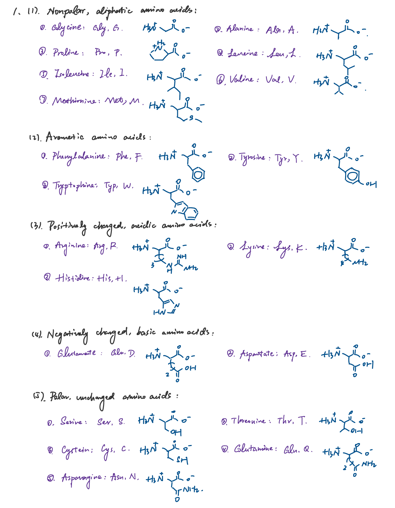
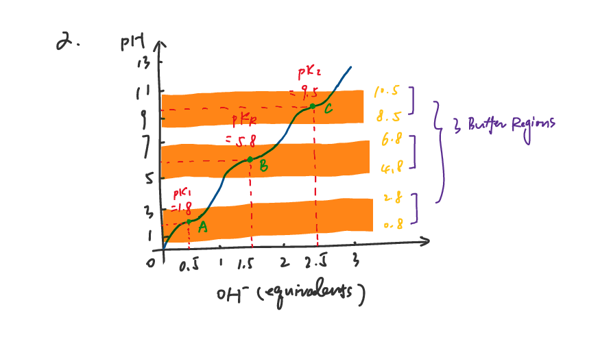

# Homework W2

> An answer `md` file for homework W2 in course *Biochemistry* by 黄悉然.

> Quickly direct to [T1](#t1), [T2](#t2), [T3](#t3) or [T4](#t4).

---
### T1
> Amino acid overview

* You may view answer for **T1** either here or in [`png`](./T1-2/T1.png) format.

---
### T2
> Titration plot for given amino acid

* You may view answer for **T2** either here or in [`png`](./T1-2/T2.png) format.

---
### T3
> Resequencing endogenous **Porcine Cytochrome c** (or **CYC_PIG**)

> You may check the original sequence of **CYC_PIG** in `fasta` format [locally](./T3/Raw%20sequence/P62895.fasta) or download it [online](https://rest.uniprot.org/uniprotkb/P62895.fasta).
> Please note that this `fasta` file contains uncleaved `Met` at the start, but since the task is to resequence mature proteins purified from tissue, this residue is manually deleted.
> Data processing are mainly completed in `Linux` operating system. You may check commands and corresponding results in the [second part](#2-results-and-commands).

##### 1. Detailed procedure for sequencing **CYC_PIG**
###### 1.1 Obtain target protein from specific *porcine* tissues via **multiple** rounds of **purification** and **assaying**;
###### 1.2 **Hydrolyze** obtained protein into separate amino acids;
> View results in `txt` format [locally](./T3/Processed%20data/P62895_hydrolyzed.txt);
> View [command](#21-hydrolyzation) for data processing.
###### 1.3 Determine amino-terminal residue;
> View [command and result](#22-amino-terminal-residue) here.
* React with `FDNB`;
* Hydrolyze and detect product;
* No disulfide bond reduction needed.
  * The 2 `C` in the sequence are too close to form a disulfide bond;
  * View [command](#23-disulfide-bond-verification) for data processing.
###### 1.4 Cleave with **trypsin** and **CNBr** and sequence by **Edman degradation**;
> View results in `txt` format locally for both [trypsin](./T3/Processed%20data/P62895.trypsin.txt) and [CNBr](./T3/Processed%20data/P62895.CNBr.txt);
> View [command](#24-cleavage-and-sequencing) for data processing.
* Cleave with **trypsin**, separate fragments, and sequence;
* Cleave with **CNBr** (cyanogen bromide), separate fragments, and sequence.
* 
    | Reagent | Cleavage points |
    | :---: | :---: |
    | Trypsin | Lys, Arg (C) |
    | CNBr | Met (C) |
###### 1.5 Establish whole sequence.
> View `R` script for data processing [here](#25-prepare-r-script-for-sequence-reconstruction) or in `R` format [locally](./T3/Processed%20data/reconstruct.R)
> View [command](#26-execute-script-and-collect-result) for data processing.
> View reconstructed sequence [locally](./T3/Processed%20data/reconstructed.fasta).
* Create `R` script for sequence reconstruction;
* Execute script.

##### 2. Results and commands
###### 2.1 Hydrolyzation

```bash
$ vim P62895.fasta  # Deletes starting methionine
$ grep -v "^>" P62895.fasta |\
> fold -w1 | sort | uniq -c |\
> awk '{print $2, $1}' >\
> P62895_hydrolyzed.txt # Saves amino acid counts as txt file
```
###### 2.2 Amino-terminal residue

```bash
$ grep -v "^>" P62895.fasta |\
> fold -w1 | head -1
# Returns
G   # The amino-terminal residue is G
```
###### 2.3 Disulfide bond verification

```bash
$ grep -v '^>' P62895.fasta |\
> fold -w1 | cat -n | grep "C"
# Returns
    14  C
    17  C
# The two cysteins are too close to form a disulfide bond
```
###### 2.4 Cleavage and sequencing

```bash
# For trypsin
$ grep -v "^>" P62895.fasta |\
> paste -sd '' |\
> sed 's/K/K\n/g; s/R/R\n/g' > P62895.trypsin.txt

# For CNBr
$ grep -v "^>" P62895.fasta |\
> paste -sd '' |\
 sed 's/M/M\n/g' > P62895.CNBr.txt
```
###### 2.5 Prepare [`R` script](./T3/Processed%20data/reconstruct.R) for sequence reconstruction

```R
#!/usr/bin/env Rscript
# N-terminal based sequence reconstruction
# Usage: Rscript reconstruct.R cnbr.txt trypsin.txt

# Read fragments
read_fragments <- function(filename) {
  lines <- readLines(filename, warn = FALSE)
  lines <- lines[lines != ""]
  return(lines)
}

# Find fragment containing N-terminus
find_n_terminal <- function(fragments, n_term) {
  for (f in fragments) {
    if (substr(f, 1, 1) == n_term) {
      return(f)
    }
  }
  return(NULL)
}

# Find trypsin fragments within CNBr sequence
find_trypsin_in_cnbr <- function(cnbr_seq, trypsin_frags) {
  results <- data.frame(
    fragment = trypsin_frags,
    found = sapply(trypsin_frags, function(f) grepl(f, cnbr_seq, fixed = TRUE)),
    stringsAsFactors = FALSE
  )
  return(results)
}

# Find trypsin fragments that bridge two CNBr fragments
find_bridging_fragments <- function(cnbr_seq1, cnbr_seq2, trypsin_frags) {
  combined <- paste0(cnbr_seq1, cnbr_seq2)
  bridging <- c()

  for (f in trypsin_frags) {
    if (!grepl(f, cnbr_seq1, fixed = TRUE) &&
        !grepl(f, cnbr_seq2, fixed = TRUE) &&
        grepl(f, combined, fixed = TRUE)) {
      bridging <- c(bridging, f)
    }
  }
  return(bridging)
}

# Main function
main <- function() {
  args <- commandArgs(trailingOnly = TRUE)

  if (length(args) < 2) {
    cat("Usage: Rscript reconstruct.R <cnbr.txt> <trypsin.txt>\n")
    quit(status = 1)
  }

  cnbr_frags <- read_fragments(args[1])
  trypsin_frags <- read_fragments(args[2])

  cat("\n")
  cat("=", rep("=", 58), "\n", sep = "")
  cat("  N-terminal based sequence reconstruction\n")
  cat("=", rep("=", 58), "\n\n", sep = "")

  cat("N-terminal residue: G\n\n")

  # Find N-terminal CNBr fragment
  n_term_cnbr <- find_n_terminal(cnbr_frags, "G")
  cat("N-terminal CNBr fragment:", n_term_cnbr, "\n\n")

  # Find trypsin fragments containing N-terminus
  n_term_trypsin <- trypsin_frags[substr(trypsin_frags, 1, 1) == "G"]
  cat("N-terminal trypsin fragments:", paste(n_term_trypsin, collapse = ", "), "\n\n")

  # List all CNBr fragments
  cat("CNBr fragment list:\n")
  for (i in 1:length(cnbr_frags)) {
    if (cnbr_frags[i] == n_term_cnbr) {
      cat("  ", i, ". ", cnbr_frags[i], " <- N-terminal\n", sep = "")
    } else {
      cat("  ", i, ". ", cnbr_frags[i], "\n", sep = "")
    }
  }

  # Try all possible orders
  cat("\n", rep("=", 58), "\n", sep = "")
  cat("Trying all possible orders...\n")
  cat(rep("=", 58), "\n\n", sep = "")

  # Other CNBr fragments
  others <- cnbr_frags[cnbr_frags != n_term_cnbr]

  # Generate all permutations
  if (length(others) == 2) {
    orders <- list(
      c(n_term_cnbr, others[1], others[2]),
      c(n_term_cnbr, others[2], others[1])
    )
  } else {
    orders <- list(c(n_term_cnbr, others))
  }

  for (order_idx in 1:length(orders)) {
    order <- orders[[order_idx]]
    seq <- paste(order, collapse = "")

    cat("Order", order_idx, ": [",
        paste(substr(order, 1, 10), "...", sep = ""),
        "]\n", sep = "")

    # Check if all trypsin fragments are in the sequence
    missing <- c()
    for (f in trypsin_frags) {
      if (!grepl(f, seq, fixed = TRUE)) {
        missing <- c(missing, f)
      }
    }

    if (length(missing) == 0) {
      cat("  ✓ All trypsin fragments found in sequence!\n")
      cat("\n", rep("=", 58), "\n", sep = "")
      cat("Final reconstructed sequence:\n")
      cat(rep("=", 58), "\n\n", sep = "")
      cat(seq, "\n")
      cat("\nLength:", nchar(seq), "amino acids\n")

      # Save result
      writeLines(c(paste0(">reconstructed_sequence"), seq), "reconstructed.fasta")
      cat("\nResult saved to: reconstructed.fasta\n")

      return()
    } else {
      cat("  ✗ Missing", length(missing), "trypsin fragments\n")
    }
  }

  cat("\nUnable to determine unique order, more information needed\n")
}

main()
```
###### 2.6 Execute script and collect result

```bash
$ Rscript reconstruct.R P62895.CNBr.txt P62895.trypsin.txt
# Returns
===========================================================
  N-terminal based sequence reconstruction
===========================================================

N-terminal residue: G

N-terminal CNBr fragment: GDVEKGKKIFVQKCAQCHTVEKGGKHKTGPNLHGLFGRKTGQAPGFSYTDANKNKGITWGEETLM

N-terminal trypsin fragments: GDVEK, GK, GGK, GITWGEETLMEYLENPK, GER

CNBr fragment list:
  1. GDVEKGKKIFVQKCAQCHTVEKGGKHKTGPNLHGLFGRKTGQAPGFSYTDANKNKGITWGEETLM <- N-terminal
  2. EYLENPKKYIPGTKM
  3. IFAGIKKKGEREDLIAYLKKATNE

==========================================================
Trying all possible orders...
==========================================================

Order1: [GDVEKGKKIF...EYLENPKKYI...IFAGIKKKGE...]
  ✓ All trypsin fragments found in sequence!

==========================================================
Final reconstructed sequence:
==========================================================

GDVEKGKKIFVQKCAQCHTVEKGGKHKTGPNLHGLFGRKTGQAPGFSYTDANKNKGITWGEETLMEYLENPKKYIPGTKMIFAGIKKKGEREDLIAYLKKATNE

Length: 104 amino acids

Result saved to: reconstructed.fasta
NULL
```
> The [output sequence](./T3/Processed%20data/reconstructed.fasta) is identical with [raw sequence](./T3/Raw%20sequence/P62895.fasta).
---
### T4
> Chromatographic technologies
##### 1. Ion-exchange chromatography
* Apply **charged materials** on column matrix;
  | Matrix | Charge |
  | :--- | :---: |
  | CM-cellulose | - |
  | DEAE-cellulose | + |
* Exploit differences of the *sign* and *magnitude* of the **net electric charges** of proteins **at a given pH** to achieve purification.
##### 2. Size-exclusion chromatography, `SEC`
* Apply **porous polymer beads** on column matrix;
* After loading sample, larger proteins go through larger pores and are therefore washed out earlier.
##### 3. Affinity chromatography
* Apply **ligand-attached beads** on column matrix;
* Target protein would **bind to ligand specifically**, therefore remains in the column;
* Target protein is **eluted by ligand solution**.
---