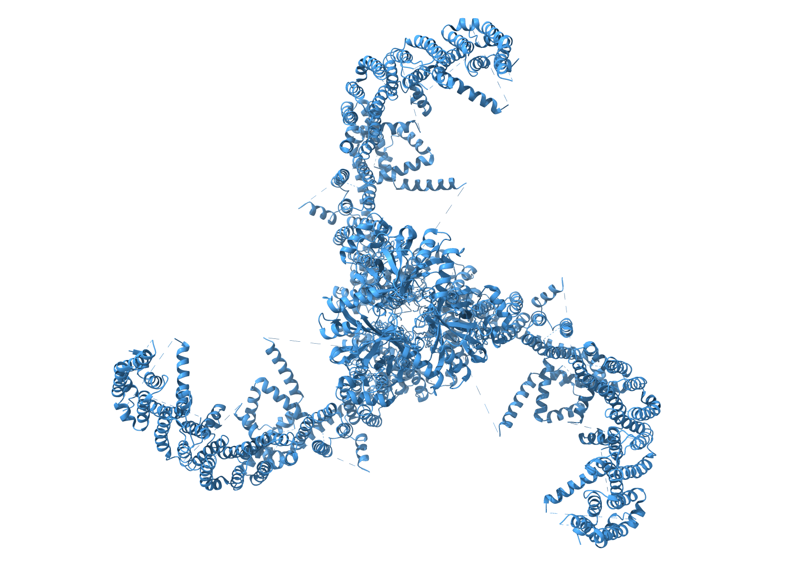
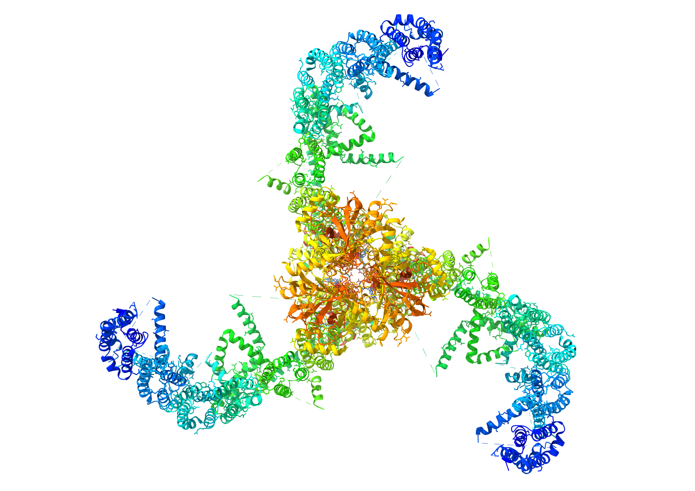
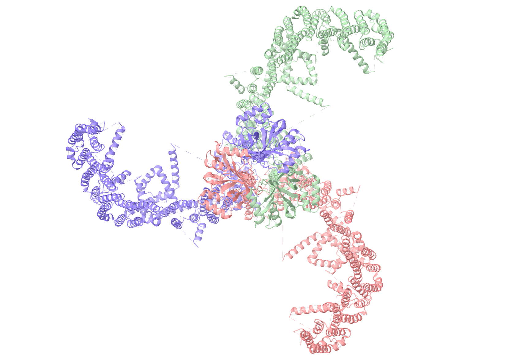
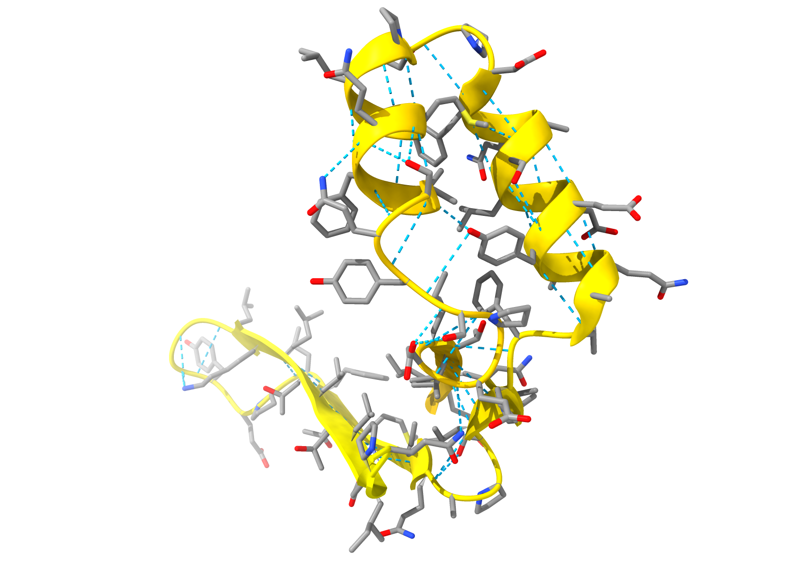
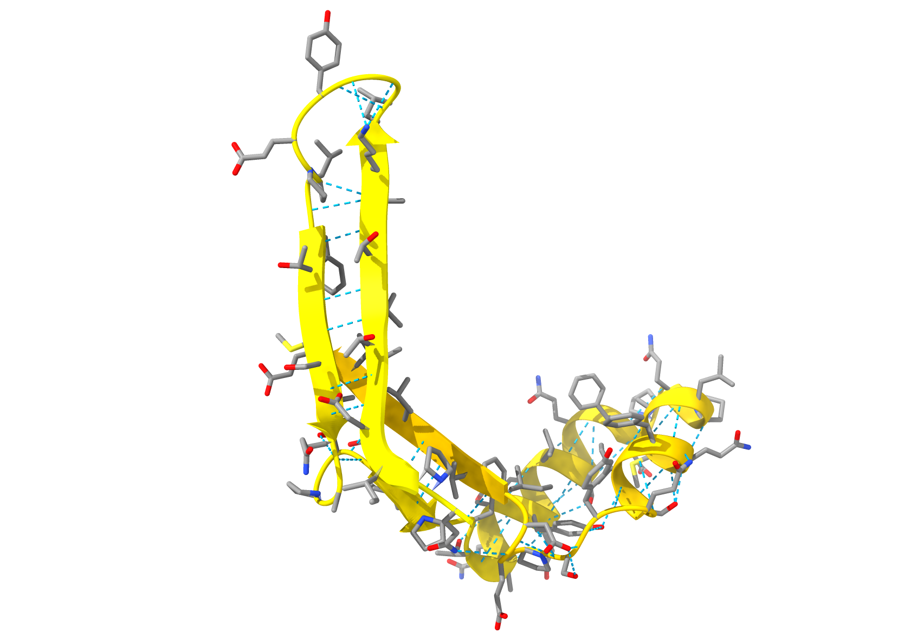
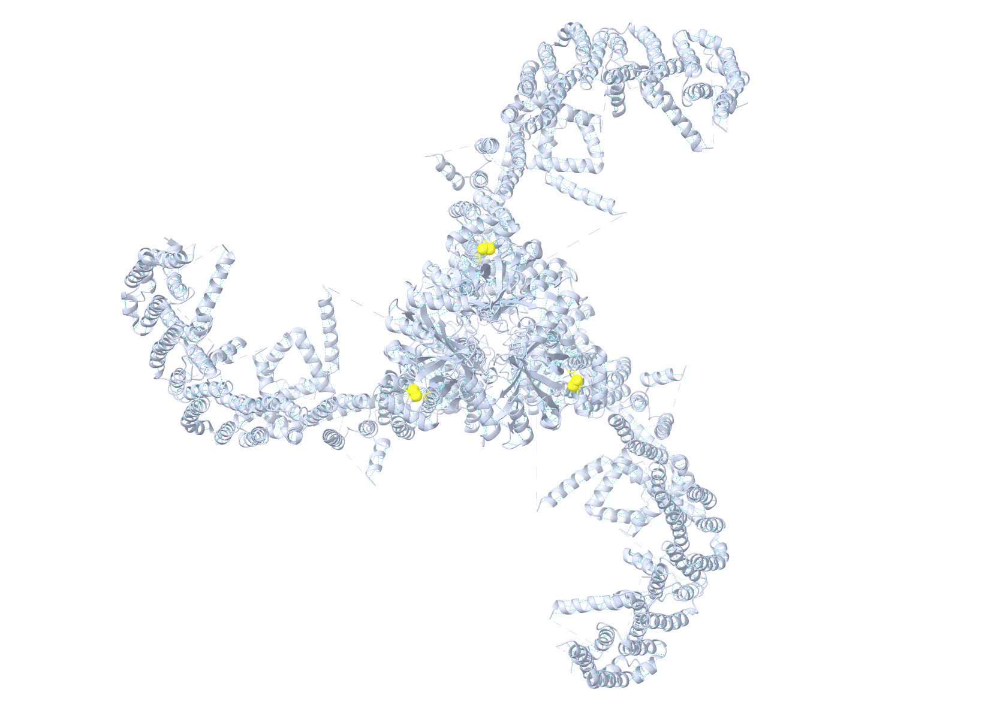
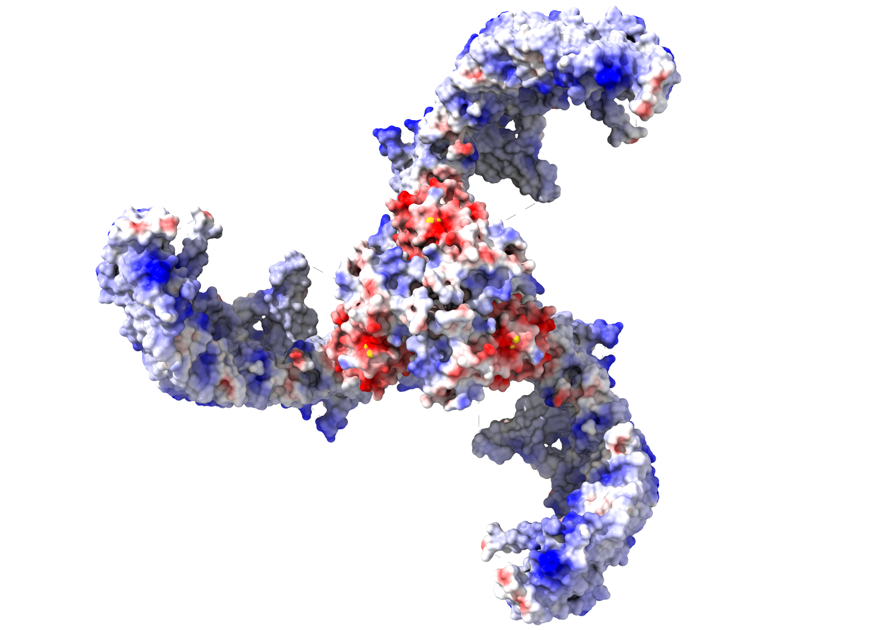
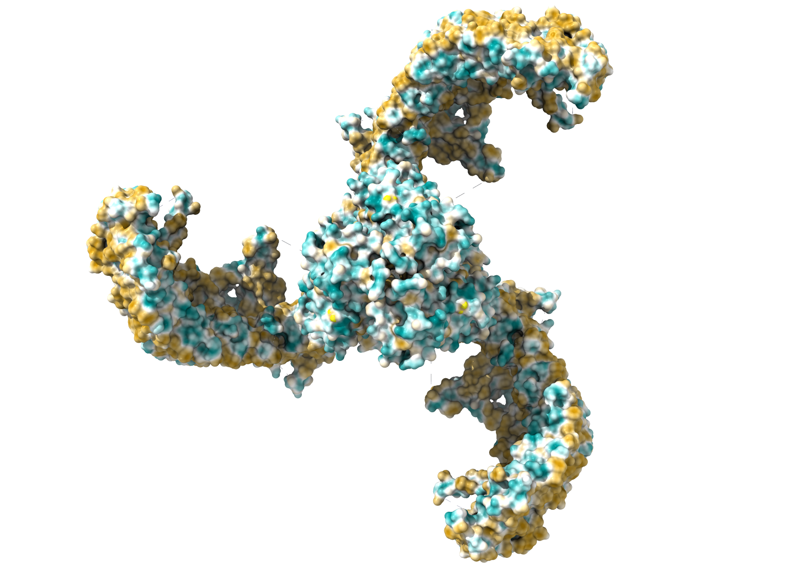
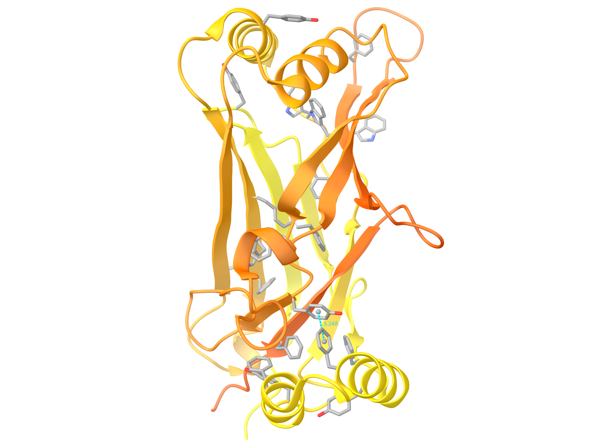

# Homework 3

> An answer `md` file for homework 3 in course *Biochemistry* by 黄悉然.

> Quickly direct to [T1](#t1), [T2](#t2), [T3](#t3) or [T4](#t4).

> View data for T1-3 [locally](./Raw%20file/hs.piezo1.ent) or [online](https://www.uniprot.org/uniprotkb/Q92508/entry). I used the structure of **Piezo1** in *homo sapiens* (UniProt ID: [Q92508](https://www.uniprot.org/uniprotkb/Q92508/entry)).
---
### T1
> Protein structure overview

* [Protein structure in monocolor](./T1/whole.monocolor.png);

* [Protein structure colored in rainbow style](./T1/whole.multicolor.png);

* [Protein structure colored based on chains](./T1/whole.chains.png) (note that **Piezo1** contains `3` identical chains);

---
### T2
> Secondary structure segment

* I chose a motif with both $\alpha$-helices and $\beta$-sheets (antiparallel);
  * chain A, site `2206-2271`.
* Hydrogen bonds are highlighted in lightblue;
* [Highlighting $\alpha$-helices](./T2/alpha.helices.png);

* [Highlighting antiparallel $\beta$-sheet (twisted)](./T2/beta.sheet.antiparallel.png).

---
### T3
> Interactions within protein

* [Hydrogen bonds and disulfide bonds](./T3/hbond&disulfide.png);

* [Electrostatic interactions](./T3/electrostatic.png) (negative and positive regions);

* [Hydrophobic effect](./T3/hydrophobic.png) (hydrophilic and hydrophobic regions)

* [$\pi$-$\pi$ interaction](./T3/pi-pi.png)
  * I chose a motif with rich aromatic amino acids and labeled a possible $\pi$-$\pi$ interaction.
    * chain A, site `2202-2428`;
    * All aromatic amino acids are shown in gray.

---
### T4
* Q1: **D**; Q2: **A**; Q3: **C**.
---