# Homework 4

> An answer `md` file for homework 4 in course *Biochemistry* by 黄悉然, made highly understandable.

> Quickly direct to [T1](#t1), [T2](#t2), [T3](#t3), [T4](#t4), [T5](#t5) or [T6](#t6). 
---
### T1
> Select disease and protein of interest.
* **Selected disease and protein;**
  * Disease: [**MCOPCB10**](https://omim.org/entry/616428), autosomal dominant **microphthalmia/coloboma**-10 (MIM ID: [#616428](https://omim.org/entry/616428));
    * **MCOPCB10** is an **AD** genetic disease caused by mutations in the **RBP4** gene[^1];
    * Manifested as ocular developmental disorders including microphthalmia, anophthalmia, and/or coloboma[^2];
    * Caused by **heterozygous mutation** in [**RBP4** gene](https://www.genenames.org/data/gene-symbol-report/#!/hgnc_id/9922) (MIM ID: [180250](https://omim.org/entry/180250); HGNC ID: [9922](https://www.genenames.org/data/gene-symbol-report/#!/hgnc_id/9922); Ensembl ID: [ENSG00000138207](https://www.ensembl.org/Homo_sapiens/Gene/Summary?g=ENSG00000138207); UCSC ID: [uc003vng.3](http://genome.cse.ucsc.edu/cgi-bin/hgGene?org=Human&hgg_chrom=none&hgg_type=knownGene&hgg_gene=uc003vng.3))[^3].
      * **RBP4**, retinol binding protein 4;
      * Encodes protein **RBP4**, a key protein in MCOPCB10 pathology.
  * Protein: [**RBP4**](https://www.uniprot.org/uniprotkb/P02753/entry), retinol-binding protein 4 (UniProt ID: [P02753](https://www.uniprot.org/uniprotkb/P02753/entry)).
    * **RBP4**, *homo sapiens*, encoded by gene RBP4;
    * Function (see reference on [UniProt](https://www.uniprot.org/uniprotkb/P02753/entry));
      * Transports **retinol (vitamin A)** from **liver** to peripheral tissues, particularly to the **retina** for visual cycle maintenance;
        * Binds retinol with high affinity ($K_d \in (0.1,1) \text{nM}$) within its **hydrophobic β-barrel pocket**;
        * Another site of RBP4 binds to receptor **[STRA6](https://www.uniprot.org/uniprotkb/Q9BX79/entry)** to transfer retinol; RBP4 with retinol (**holo-RBP4**) molecules have greater binding capacity with STRA6 compared to those without (**apo-RBP4**), due to conformational changes induced by RBP4 binding.
      * Due to the small size of holo-RBP4, it binds with **TTR** to form a tetramer to prevent its loss through renal filtration;
      * Also relevant with Type II diabetes, obesity, etc.
    * Ligand: [**retinol (vitamin A)**](https://pubchem.ncbi.nlm.nih.gov/compound/445354)

      ```smiles
      CC1=C(C(CCC1)(C)C)/C=C/C(=C/C=C/C(=C/CO)/C)/C
      ```
    * Family: **Lipocalin** family;
    * Length: 201 aa (amino acids); MW: ~21 kDa;
    * Pathology and variants[^4].
      * Pathological variants: [**A73T**](https://web.expasy.org/variant_pages/VAR_073856.html) and [**A75T**](https://web.expasy.org/variant_pages/VAR_073857.html);
      * Molecular pathology:
        * Site **73** and **75** are located in the **hydrophobic β-barrel pocket**, binding pocket of retinol;
        * These mutations from hydrophobic residues to hydrophilic ones are unfavorable for retinol binding and conformation stability;
        * As a result, the variants' binding efficiency with retinol is compromised, while the conformational changes increase their affinity with STRA6.
      * Physiological pathology
        * The mutated proteins prevail in competition with normal proteins to bind with receptor STRA6 yet deliver less retinol, making the mutation a dominant one;
        * Lack of retinol in eye tissues result in a disorder of eye formation.
* **Downloaded relevant data.**
  * All source data are stored in folder [**Source Data**](./Source%20Data/) under parent folder;

    [Source Data](./Source%20Data/)
    ├── [RBP4.seq.fasta](./Source%20Data/RBP4.seq.fasta)
    └── [RBP4.str.pdb](./Source%20Data/RBP4.str.pdb)
  * Including sequence in [`fasta` format](https://rest.uniprot.org/uniprotkb/P02753.fasta) and [`pdb` structure with ligand](https://www.rcsb.org/structure/1RBP); click to view web source;
    > Note that the [`fasta` file](./Source%20Data/RBP4.seq.fasta) is the whole sequence with signaling peptide, while the downloaded [`pdb` file](./Source%20Data/RBP4.str.pdb) is the mature structure without; the [prediction structure file](./Results/Predict/RBP4_str_predict/seed_2802/predictions/RBP4_str_predict_sample_0.cif) generated in [T2](#t2) is derived from the downloaded whole sequence, making it an immature structure.
  * Check [`fasta` file](./Source%20Data/RBP4.seq.fasta) here.

    ```fasta
    >sp|P02753|RET4_HUMAN Retinol-binding protein 4 OS=Homo sapiens OX=9606 GN=RBP4 PE=1 SV=3
    MKWVWALLLLAALGSGRAERDCRVSSFRVKENFDKARFSGTWYAMAKKDPEGLFLQDNIV
    AEFSVDETGQMSATAKGRVRLLNNWDVCADMVGTFTDTEDPAKFKMKYWGVASFLQKGND
    DHWIVDTDYDTYAVQYSCRLLNLDGTCADSYSFVFSRDPNGLPPEAQKIVRQRQEELCLA
    RQYRLIVHNGYCDGRSERNLL
    ```
---
### T2
> Protein structure prediction.
* **Run prediction on [ProteinX server](https://protenix-server.com/);**
  * Submit the following sequence and set default parameters;

    ```
    MKWVWALLLLAALGSGRAERDCRVSSFRVKENFDKARFSGTWYAMAKKDPEGLFLQDNIVAEFSVDETGQMSATAKRVRLLNNWDVCADMVGTFTDTEDPAKFKMKYWGVASFLQKGNDDHWIVDTDYDTYAVQYSCRLLNLDGTCADSYSFFSRDPNGLPPEAQKIVRQRQEELCLARQYRLIVHNGYCDGRSERNLL
    ```
  * Results are in folder [Predict](./Results/Predict/) under folder [Results](./Results/);
  * Later analysis are mostly based on this `cif` file: [RBP4_str_predict_sample_0.cif](./Results/Predict/RBP4_str_predict/seed_2802/predictions/RBP4_str_predict_sample_0.cif).
* **Operate on `cif` file with ChimeraX**

    ```bash
    # 1. Open file
    open <path_to_cif_file> format mmcif

    # 2. Set basic display arguments
    set bgColor white
    color #1 #366d47ff
    lighting simple

    # 3. Highlight variant sites: 73A and 75A
    select :73,75
    show sel atoms
    style sel ball
    color sel #8B6508

    # 4. Create labels
    label :73 text A73T
    label :75 text A75T
    label height 1.5
    label color #ffd87e

    # 5. Save figure
    select clear
    save <path_to_png_file> width 3000 height 2000 supersample 3
    ```
* **Acquire figures.**
  * [Fig.1a](./Processed/Predict/RBP4.pred.mut.1.png) shows the overall view of the protein, with the α-helix on the left being the unsevered signaling peptide;
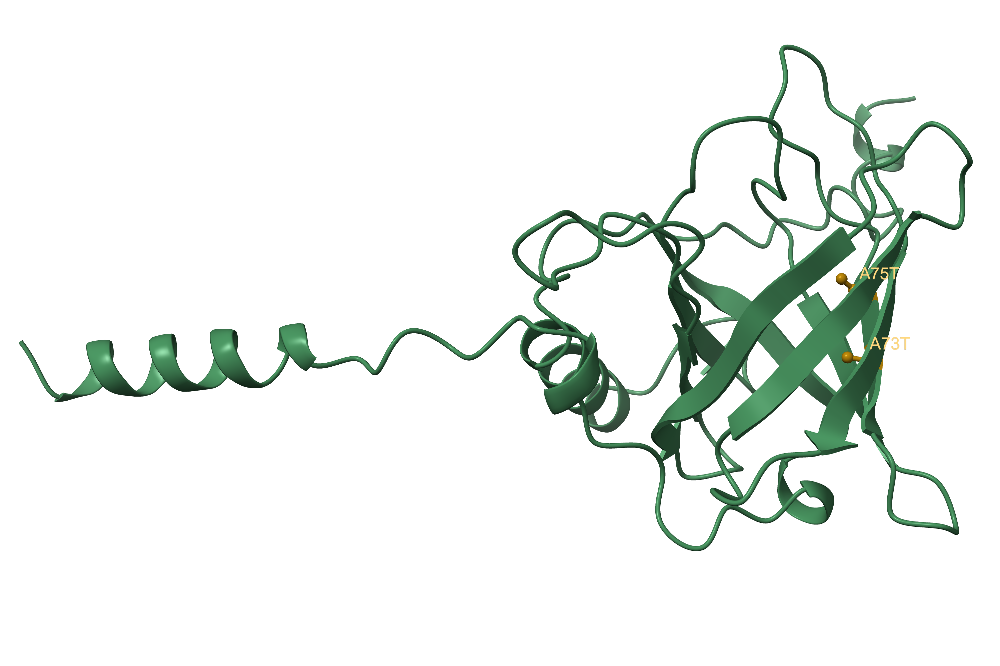
  * [Fig.1b](./Processed/Predict/RBP4.pred.mut.2.png) shows the overall view of the protein excluding the signaling peptide and highlighting the β-barrel;
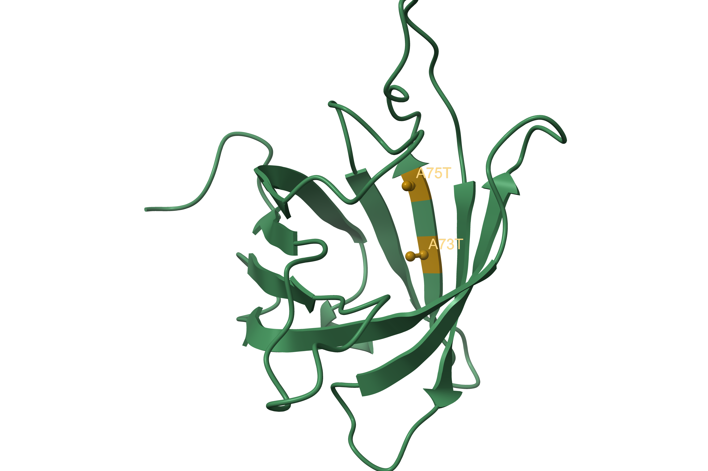
  * [Fig.1c](./Processed/Predict/RBP4.pred.mut.3.png) shows the detailed image of the mutation sites inside the β-barrel.
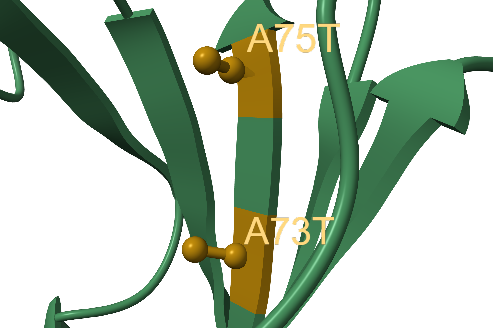
---
### T3
> Identify most promising binding pocket.

> In this section, RBP4 structure is still based on prediction from [T2](#t2).
* **Preparation;**
  * In the last `chimera` session (from [T2](#t2)), we may use the following command to convert the [`cif` file](./Results/Predict/RBP4_str_predict/seed_2802/predictions/RBP4_str_predict_sample_0.cif) to a [`pdb` file](./Results/Pocket/RBP4.str.predict.pdb); this step is for convenience in later analysis;

    ```bash
    save <path_to_pdb_file> format pdb models #1
    ```
  * Another approach is to convert the file in `linux` (if you're unfamiliar with `linux`, it's an operation system like `MacOS` or `Windows`) using the following commands.
    > `apt` command is primarily used in `Ubuntu`/`Debian`; for `Red Hat`/`CentOS` users, use `yum`; for `Fedora` users, use `dnf`; for `Alpine` users, use `apk`.

    ```bash
    $ apt-get update
    # If you are not root user, use sudo instead
    $ apt-get install -y openbabel
    $ obabel <path_to_cif_file> -O <path_to_pdb_file>
    ```
* **Predict promising binding pockets in `linux`;**
  * If you are unfamiliar with operating in `linux` for bioinformatic analysis, watch [this teaching video](https://b23.tv/xMzD6oO) in bilibili to get a quick start;
    * We first need to install `miniconda3` and `mamba`;

      ```bash
      # Change to your working directory
      $ cd <your_working_dir>

      # Install miniconda3
      $ wget -c https://mirrors.tuna.tsinghua.edu.cn/anaconda/miniconda/Miniconda3-latest-Linux-x86_64.sh
      $ bash Miniconda3-latest-Linux-x86_64.sh
      $ source ~/.bashrc
      # If you don't have wget, use apt or yum command lines to install wget

      # Install mamba
      $ conda install -n base mamba -c conda-forge -y
      ```
    * Then we need to move the [`pdb` file](./Results/Pocket/RBP4.str.predict.pdb) to our working directory.
  * Install and run `fpocket` for pocket prediction;

    ```bash
    # Install fpocket
    $ mamba install -c conda-forge fpocket

    # Run fpocket
    $ fpocket -f RBP4.str.predict.pdb
    # Aftercompletion, the results are stored in a directory called RBP4.str.predict_out.
    ```
  * View [results](./Results/Pocket/RBP4.str.predict_out/).
    * Under this folder, there are 2 files that are important;

      [RBP4.str.predict_out](./Results/Pocket/RBP4.str.predict_out/)
      ├── [RBP4.str.predict_info.txt](./Results/Pocket/RBP4.str.predict_out/RBP4.str.predict_info.txt)
      └── [pockets](./Results/Pocket/RBP4.str.predict_out/pockets/)
          └── [pocket1_atm.pdb](./Results/Pocket/RBP4.str.predict_out/pockets/pocket1_atm.pdb)
    * [RBP4.str.predict_info.txt](./Results/Pocket/RBP4.str.predict_out/RBP4.str.predict_info.txt) is a table that lists the credibility (score) of each predicted pocket;
    * [pocket1_atm.pdb](./Results/Pocket/RBP4.str.predict_out/pockets/pocket1_atm.pdb) is a `pdb` file that depicts all atoms predicted to form the most possible pocket among all.
* **Visualization in ChimeraX.**
  * Pipeline;
    * Open files and set basic outlook;

      ```bash
      # Open files
      open <path_to_cif_file> format mmcif
      open <path_to_atm.pdb_file>

      # Set background and basic settings
      set bgColor white
      color #1 #366d47ff
      lighting simple

      hide #2.1 models
      select #2
      color sel #87ceeb
      style sel ball
      ```
    * Visualize pocket;

      ```bash
      # We can show the surface of atoms to visualize the pocket
      show sel surface
      color #2.2 #7cbbbeff
      transparency 70
      ```
    * Determine pocket residues and highlight them;

      ```bash
      # We can determine pocket residues by setting a distance threshold, like 3.5 Å
      select #1 & #2 :<3.5

      # Save information on the pocket residues for later analysis as txt file
      info residues sel saveFile <path_to_txt_file>

      # Highlight selected residues
      show sel atoms
      color sel byatom

      select #1 & ~sel
      color sel lightgrey
      transparency sel 90 target ac
      ```
    * Record spin movies and save figures;
    * Show mutation sites reletive to the pocket.

      ```bash
      # Modify certain outlook
      select #2
      color sel lightgrey target a

      # Highlight mutation sites
      select #1:73,75
      color sel #8B6508

      label :73@ca text A73T
      label :75@ca text A75T
      label height 1.5
      label color #ffd87e
      ```
  * Acquire results.
    * [Fig.2a](./Processed/Pocket/pocket.predict.1.png) and [Mov.2a](./Processed/Pocket/pocket.predict.1.mp4) shows the overview of the pocket; the pocket and pocket atoms are colored in lightblue, with residues within the pocket colored darkgreen;
  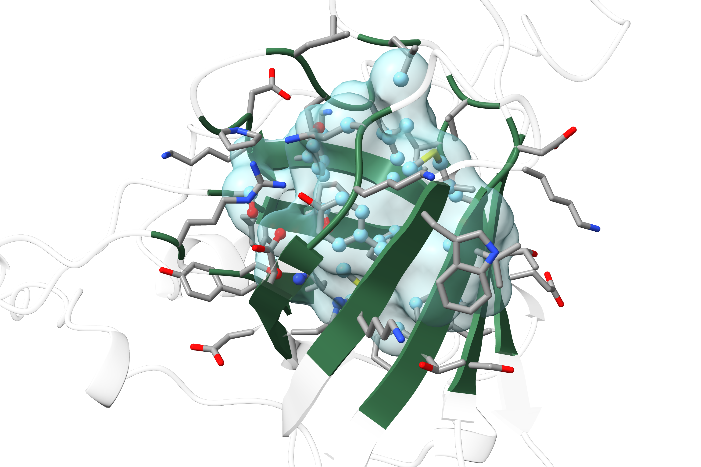

    * [Fig.2b](./Processed/Pocket/pocket.predict.2.png) and [Mov.2b](./Processed/Pocket/pocket.predict.2.mp4) shows the relative position of mutation sites with the predicted pocket; mutation sites are colored in gold;
  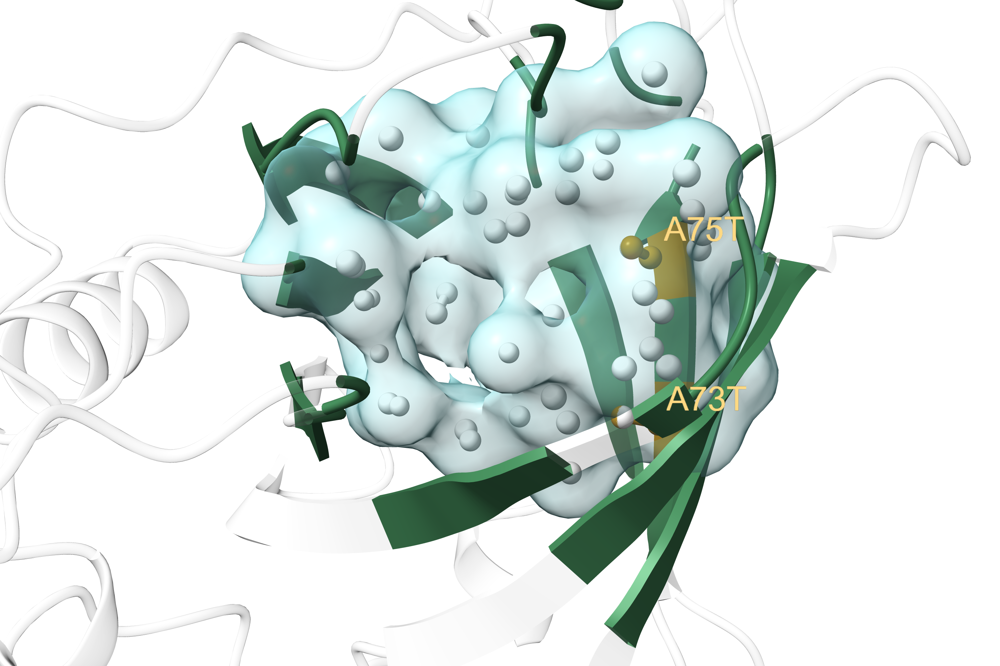

    * [pocket.predict.residues.txt](./Processed/Pocket/pocket.predict.residues.txt) shows all information on predicted residues that constitute the pocket.
      > The column for `index` in this `txt` file equals to a residue's position subtracted by 1. This is because in bioinformatic studies, `index` starts with 0, while position starts with 1.
      * We can analyze this file with the following commands in `linux`;

        ```bash
        $ wc -l pocket.predict.residues.txt
        46 pocket.predict.residues.txt
        # Suggests that this pocket is constituted by 46 residues
        ```
        
        ```bash
        $ awk -F' ' '{print $5}' pocket.predict.residues.txt |\
        > sort | uniq -c | sort -rn
              5 PHE
              5 LYS
              5 ALA
              4 SER
              4 ASP
              3 TYR
              3 MET
              3 LEU
              2 VAL
              2 THR
              2 GLY
              2 GLN
              1 TRP
              1 PRO
              1 ILE
              1 HIS
              1 GLU
              1 ARG
        # Counts all residues sorted by type
        ```
      * We can also create a [`bash` script](./Scripts/Pocket/pocket.predict.residues.count.sh) to separate hydrophobic and hydrophilic residues;
        * [Script](./Scripts/Pocket/pocket.predict.residues.count.sh);

          ```bash
          # Edit script in vim
          vim pocket.predict.residues.count.sh
          ```

          ```bash
          #!/bin/bash
          # Usage: ./pocket.predict.residues.count.sh <count_file> <original_file>
          # Example: ./pocket.predict.residues.count.sh pocket.predict.residues.count.txt pocket.predict.residues.txt

          count_file="$1"
          orig_file="$2"

          # 1. Collect positions for each AA from original file
          awk '
          BEGIN {
              split("GLY,ALA,VAL,LEU,ILE,MET,PHE,TRP,PRO", hydro, ",");
              for (i in hydro) hydrophobic[hydro[i]] = 1;
              split("SER,THR,TYR,ASN,GLN,LYS,ARG,HIS,ASP,GLU", hydrophi, ",");
              for (i in hydrophi) hydrophilic[hydrophi[i]] = 1;
              
              hydro_all = "";
              phil_all = "";
          }
          {
              # Extract residue ID
              match($0, /#1\/A:([0-9]+)/);
              pos = substr($0, RSTART+5, RLENGTH-5);
              aa = $5;
              
              if (aa in hydrophobic) {
                  # Per-residue positions
                  hydro_pos[aa] = hydro_pos[aa] ? hydro_pos[aa] "," pos : pos;
                  hydro_sum[aa]++;
                  # Combined positions
                  hydro_all = hydro_all ? hydro_all "," pos : pos;
              } else if (aa in hydrophilic) {
                  # Per-residue positions
                  phil_pos[aa] = phil_pos[aa] ? phil_pos[aa] "," pos : pos;
                  phil_sum[aa]++;
                  # Combined positions
                  phil_all = phil_all ? phil_all "," pos : pos;
              }
          }
          END {
              # Print
              printf "=== Hydrophobic Combined Positions ===\n";
              printf "%s\n\n", hydro_all;
              
              printf "=== Hydrophobic by Residue Type ===\n";
              for (aa in hydro_pos) {
                  printf "  %s (n=%d): %s\n", aa, hydro_sum[aa], hydro_pos[aa];
              }
              
              printf "\n=== Hydrophilic Combined Positions ===\n";
              printf "%s\n\n", phil_all;
              
              printf "=== Hydrophilic by Residue Type ===\n";
              for (aa in phil_pos) {
                  printf "  %s (n=%d): %s\n", aa, phil_sum[aa], phil_pos[aa];
              }
          }' "$orig_file"

          # 2. Calculate ratios from count file
          awk '
          BEGIN {
              split("GLY,ALA,VAL,LEU,ILE,MET,PHE,TRP,PRO", hydro, ",");
              for (i in hydro) hydrophobic[hydro[i]] = 1;
              split("SER,THR,TYR,ASN,GLN,LYS,ARG,HIS,ASP,GLU", hydrophi, ",");
              for (i in hydrophi) hydrophilic[hydrophi[i]] = 1;
              total_hydrophobic = 0;
              total_hydrophilic = 0;
          }
          {
              if ($2 in hydrophobic) total_hydrophobic += $1;
              else if ($2 in hydrophilic) total_hydrophilic += $1;
          }
          END {
              total = total_hydrophobic + total_hydrophilic;
              if (total > 0) {
                  printf "\n=== Summary ===\n";
                  printf "Hydrophobic: %d (%.2f%%)\n", total_hydrophobic, total_hydrophobic/total*100;
                  printf "Hydrophilic: %d (%.2f%%)\n", total_hydrophilic, total_hydrophilic/total*100;
                  printf "Ratio (Hpho/Hphi): %.2f\n", total_hydrophobic/total_hydrophilic;
              }
          }' "$count_file"
          ```
        * Run [script](./Scripts/Pocket/pocket.predict.residues.count.sh);

          ```bash
          # Alter access to script
          $ chmod 754 pocket.predict.residues.count.sh

          # Prepare input file
          $ awk -F' ' '{print $5}' pocket.predict.residues.txt |\
          > sort | uniq -c | sort -rn > pocket.residues.count.txt
          ```

          ```bash
          # Run
          $ ./pocket.predict.residues.count.sh pocket.predict.residues.count.txt pocket.predict.residues.txt
          === Hydrophobic Combined Positions ===
          44,45,46,50,53,54,55,59,61,63,73,75,78,80,90,91,92,94,105,108,117,152,153

          === Hydrophobic by Residue Type ===
            GLY (n=2): 92,117
            LEU (n=3): 53,55,80
            PRO (n=1): 50
            ILE (n=1): 59
            MET (n=3): 45,90,105
            PHE (n=5): 54,63,94,152,153
            TRP (n=1): 108
            ALA (n=5): 44,46,61,73,75
            VAL (n=2): 78,91

          === Hydrophilic Combined Positions ===
          47,48,49,62,72,74,76,89,93,106,107,115,116,119,120,121,134,135,136,138,149,150,151

          === Hydrophilic by Residue Type ===
            GLN (n=2): 115,134
            THR (n=2): 74,93
            TYR (n=3): 107,135,150
            LYS (n=5): 47,48,76,106,116
            SER (n=4): 72,136,149,151
            ASP (n=4): 49,89,119,120
            HIS (n=1): 121
            GLU (n=1): 62
            ARG (n=1): 138

          === Summary ===
          Hydrophobic: 23 (50.00%)
          Hydrophilic: 23 (50.00%)
          Ratio (Hpho/Hphi): 1.00
          ```
        * With the results above, we may highlight hydrophobic and hydrophilic residues respectively in ChimeraX (within the previous session) and show their relative position to the protein surface (inside or outside the surface).
          * Pipeline;

            ```bash
            # 1. Calculate SASA (an index: the smaller, the deeper a residue is embedded in the protein)
            measure sasa #1 & protein setAttribute true

            # 2. Select hydrophobic/philic residues
            select #1/A:<the_position_vector_of_hydrophobic/philic_residues>
            # This vector is shown in the results from running the bash script
            show sel atoms
            color sel lightgrey target a

            # 3. Single out embedded residues via SASA
            select #1/A:<the_position_vector_of_hydrophobic/philic_residues> ::area<10
            # From this step we can know that 4 hydrophilic and 9 hydrophobic residues can be termed embedded
            color sel #8B6508 target a

            # 4. Save png file
            select clear
            save <path_to_png_file> width 3000 height 2000 supersample 3
            ```
          * Acquire figures.
            * [Fig.2c](./Processed/Pocket/pocket.predict.3.png) shows hydrophobic residues among all pocket residues; embedded residues (9 out of 25) are shown in gold with others shown in lightgrey;
          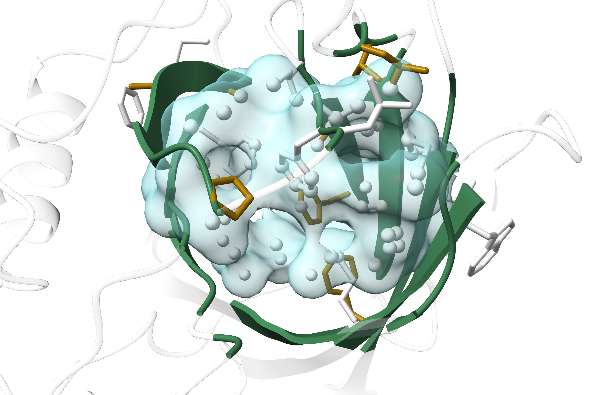
            * [Fig.2d](./Processed/Pocket/pocket.predict.4.png) shows hydrophilic residues among all pocket residues; embedded residues (4 out of 25) are shown in gold with others shown in lightgrey;
          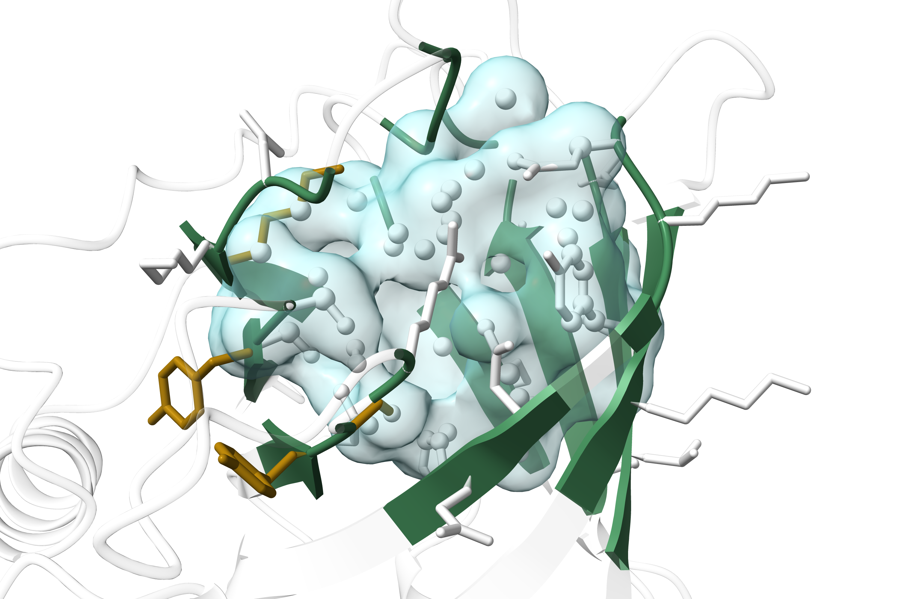
            * These results combined suggests that **the pocket core is more likely hydrophobic**, with the hydrophilic residues mainly oriented outwards to keep the core stable.

---
### T4
> Perform virtual screening for ligand.

> In this section, RBP4 structure is still based on prediction from [T2](#t2).
* **Screening for potential ligands with [DrugCLIP](https://www.drugclip.com/);**
  * Parameters and inputs;
    * 1. Upload protein `pdb` files;
      * Uploaded [RBP4_str_predict_sample_0.cif](./Results/Predict/RBP4_str_predict/seed_2802/predictions/RBP4_str_predict_sample_0.cif).
    * 2. Specify the pocket location;
      * By Center Coordinates: use predicted residues from [T3](#t3).
        * In `linux`, run the following command;

          ```bash
          $ awk -F ' ' '{print $3}' pocket.predict.residues.txt |\
          > awk -F ':' '{printf $2 ","}'
          44,45,46,47,48,49,50,53,54,55,59,61,62,63,72,73,74,75,76,78,80,89,90,91,92,93,94,105,106,107,108,115,116,117,119,120,121,134,135,136,138,149,150,151,152,153,#
          ```
        * In ChimeraX, run the following commands;
          ```bash
          select #1/A:44,45,46,47,48,49,50,53,54,55,59,61,62,63,72,73,74,75,76,78,80,89,90,91,92,93,94,105,106,107,108,115,116,117,119,120,121,134,135,136,138,149,150,151,152,153
          measure center sel
          Center of mass of 378 atoms = (-9.23, -3.06, 1.41)
          ```
        * Input the coordinate into the platform.
    * 3. Others.
      * Library: Public, check all;
      * Model: Default_Model;
      * Top_K: 100;
      * Task info: RBP4.screening.
  * Outputs.
    * Cluster results (threshold: 0.65);
    * Selected top 5 ligands in DrugCLIP score.
      * Downloaded corresponding `SMILES` information in [`csv` file](./Results/Screening/ligands.csv).
* **Molecular docking via VinaDock module.**
  * Performed VinaDock analysis for the top 5 candidates with highest DrugCLIP score;
  * Downloaded corresponding `SMILES` information in [`csv` file](./Results/Screening/ligands.with.Vinascore.csv);

    | Mol ID | DrugClip Score | Vina Docking Score |
    | :--- | :--- | :--- |
    | STL592018 | 3.14 | 43.81 |
    | F473-2218 | 3.07 | 3.87 |
    | OSSL_321529 | 2.83 | 2.55 |
    | STK174716 | 2.78 | 0.04 |
    | Z241121656 | 2.77 | 33.99 |
  * It is obvious that [the first candidate (Mol ID: STL592018)](https://pubchem.ncbi.nlm.nih.gov/compound/1109041) would be the best ligand.
    * Ligand structure;

      ```smiles
      O=C1C=CC(=O)N1c2ccc(cc2)-c(nc3-c4ccccc4)cc(n3)-c(cc5)ccc5N6C(=O)C=CC6=O
      ```
    * Downloaded docked `pdb` file [STL592018.docked.pdb](./Results/Screening/STL592018.docked.pdb).
---
### T5
> Detailed interactions.

> In this section, docked `pdb` file is of the best ligand screened in [T4](#t4).
* **Basic visualization in ChimeraX;**
  * Pipeline;

    ```bash
    # Open file
    open <path_to_pdb_file>

    # Disassociate ligand from protein
    select #1 & ligand
    split #1 & sel

    # Basic outlook settings
    set bgColor white

    select #1.2
    color sel byatom target a
    color sel #366d47ff target r
    transparency 35 target a
    transparency 65 target r

    select #1.1
    color sel #8B6508
    ```

  * Acquire figures.
    * [Fig.3a](./Processed/Interactions/interactions.1.png) shows the selected ligand structure (colored by atom);
  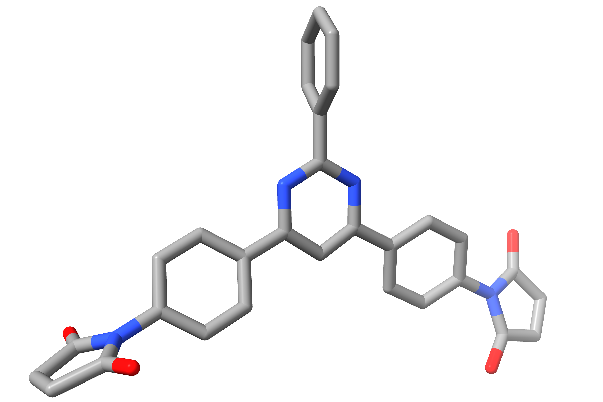
    * [Fig.3b](./Processed/Interactions/interactions.2.png) shows the relative position of the ligand to the protein and pocket.
  
* **Interaction hunting;**
  > I used the online analyzing platform **[PLIP](https://plip-tool.biotec.tu-dresden.de/plip-web/plip/index)** (Protein Ligand-Interaction Profiler) to analyze potential protein-ligand interactions.
  * Input: submitted `pbd` file [STL592018.docked.pdb](./Results/Screening/STL592018.docked.pdb);
  * Output: a [`txt` file](./Results/Interactions/report.txt) listing all interactions found and a [`pse` file](./Results/Interactions/STL592018_COMPLEX_PROTEIN_UNL_L_1.pse) that visualizes interactions in a PyMol session, and you may also check results on [webpage](https://plip-tool.biotec.tu-dresden.de/plip-web/plip/result/61e0171a-6322-4af5-ae71-994f8d057af2);
    > [**PyMol**](https://www.pymol.org/) is another structure analysis software similar to **coot**; you may acquire your PyMol license by agreeing to use PyMol for educational purposes solely.
    * Elaboration on `txt` report columns;

      | Column | Name | Meaning | Example |
      | :--- | :--- | :--- | :--- |
      | **RESNR** | Protein residue number | Residue ID in protein chain | `38` |
      | **RESTYPE** | Protein residue type | 3-letter amino acid code | `PHE` |
      | **RESCHAIN** | Protein chain ID | Chain identifier | `R` |
      | **RESNR_LIG** | Ligand residue number | Ligand residue ID | `1` |
      | **RESTYPE_LIG** | Ligand residue type | Usually `UNL` | `UNL` |
      | **RESCHAIN_LIG** | Ligand chain ID | Chain identifier | `L` |
      | **DIST** | Distance | Interaction distance (Å) | `3.16` |
      | **LIGCARBONIDX** | Ligand carbon index | Ligand C atom index | `1624` |
      | **PROTCARBONIDX** | Protein carbon index | Protein C atom index | `311` |
      | **LIGCOO** | Ligand coordinates | (x, y, z) in Å | `-3.952, 0.540, 6.468` |
      | **PROTCOO** | Protein coordinates | (x, y, z) in Å | `-2.068, 0.210, 8.989` |
      | **SIDECHAIN** | Sidechain involvement | `True` = sidechain involved | `True` |
      | **DIST_H-A** | H to acceptor distance | Distance (Å) | `2.73` |
      | **DIST_D-A** | Donor to acceptor distance | Distance (Å) | `3.50` |
      | **DON_ANGLE** | Donor angle | Angle (degrees) | `139.41` |
      | **PROTISDON** | Protein is donor? | `True` = protein donates H | `True` |
      | **DONORIDX** | Donor atom index | PDB atom index | `947` |
      | **DONORTYPE** | Donor atom type | e.g., `O3`, `Ng+` | `O3` |
      | **ACCEPTORIDX** | Acceptor atom index | PDB atom index | `1614` |
      | **ACCEPTORTYPE** | Acceptor atom type | e.g., `Nar` | `Nar` |
      | **PROT_IDX_LIST** | Protein atom index list | Comma-separated ring atom indices | `505,506,507,508,509,510` |
      | **CENTDIST** | Center distance | Distance between ring centers (Å) | `4.15` |
      | **ANGLE** | Interplanar angle | Angle between ring planes (deg) | `66.37` |
      | **OFFSET** | Ring offset | Perpendicular distance between planes (Å) | `0.59` |
      | **TYPE** | Stacking type | `T` = T-shaped, `P` = parallel | `T` |
      | **LIG_IDX_LIST** | Ligand atom index list | Comma-separated ring atom indices | `1621,1623,1624,1625,1626` |
    * Summary table.
      > Note that the residue indexes below starts with `0`. For instance, the original 120 Asp is denoted 119D.

      | Interaction Type | Counts | Residues Involved |
      | :--- | :--- | :--- |
      | Hydrophobic | 14 | 38F, 42W, 54F, 54F, 55L, 55L, 80L, 107Y, 114L, 115Q, 119D, 134Q, 138R, 153F |
      | Hydrogen Bonds | 3 | 119D, 136S, 138R |
      | π-Stacking | 2 | 63F, 153F |
  * Visualize in **PyMol**.
    * Pipeline;

      ```bash
      # First load from the pse file downloaded from PLIP
      # Basic Settings
      PyMOL>set antialias, 2
      Setting: antialias set to 2.
      PyMOL>set ray_opaque_background, 1
      Setting: ray_opaque_background set to 1.
      PyMOL>cmd.color_deep("cyan", 'HBonds', 0)

      # Show only residues involved in one specific interaction
      PyMOL>select res, STL592018_complex_Protein & resi <RESID>
      # <RESID> is the string of IDs of residues involved in the interaction
      # e.g., 63+153 for π-stacking
      PyMOL>select other, STL592018_complex_Protein & not (res or resn UNL)
      # Selected all atoms in protein except previously selected atoms and UNL (code for the ligand)
      PyMOL>cmd.hide("sticks"    ,"other_atoms")
      # Hide other atoms

      # Save as figure
      PyMOL>ray 3500, 2500
      # Ray is a rendering function
      PyMOL>png <path_to_your_figure>, dpi=300
      ```

    * Acquire figures.

      * [Fig.3c](./Processed/Interactions/interactions.3.png) shows **all interactions** detected;
    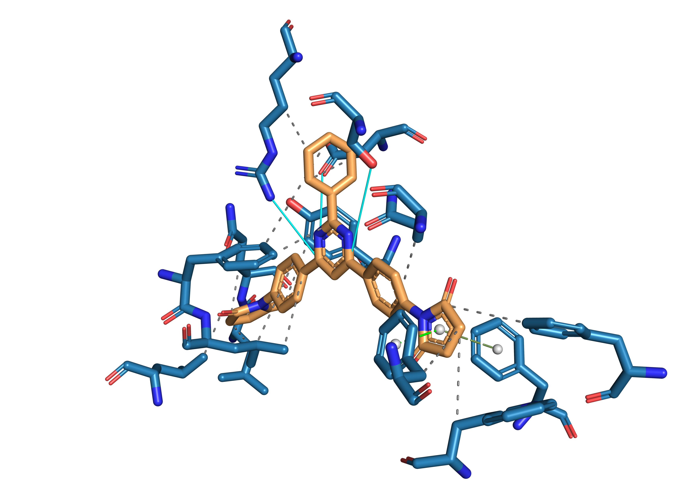
        > <span style="color: #246F9E">Protein residues</span>, <span style="color: #C7894C">ligand</span>; <span style="color: #27FEFE">hydrogen bonds</span>, <span style="color: #717171">hydrophobic interactions</span>, <span style="color: #6C8C4C">T-shaped π-stacking</span>, <span style="color: #00F800">parallel π-stacking</span>.
      * [Fig.3d](./Processed/Interactions/interactions.4.png) shows **hydrogen bonds** detected;
    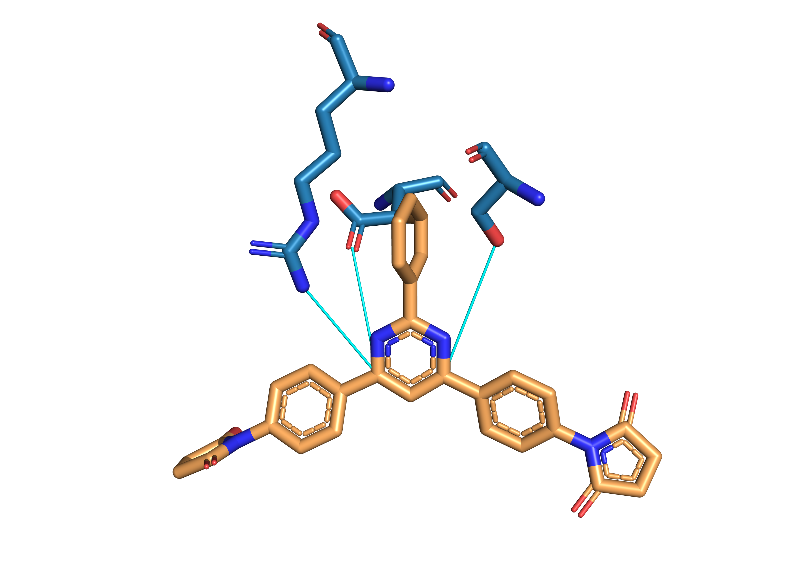
        > <span style="color: #246F9E">Protein residues</span>, <span style="color: #C7894C">ligand</span>; <span style="color: #27FEFE">hydrogen bonds</span>.
        * Note that the lengths of these hydrogen bonds may exceed normal lengths, which is a result of **loose** hydrogen bond hunting; you may interpret these interactions as **electrostatic interactions or dipolar interactions** weaker than hydrogen bonds.
      * [Fig.3e](./Processed/Interactions/interactions.5.png) shows **hydrophobic interactions** detected;
    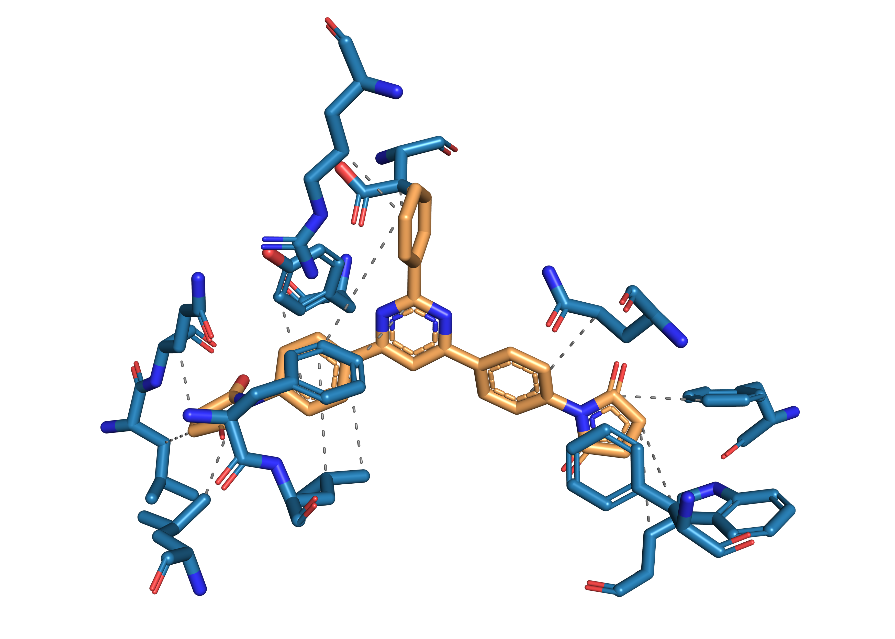
        > <span style="color: #246F9E">Protein residues</span>, <span style="color: #C7894C">ligand</span>; <span style="color: #717171">hydrophobic interactions</span>.
      * [Fig.3f](./Processed/Interactions/interactions.6.png) shows **π-stackings** detected.
    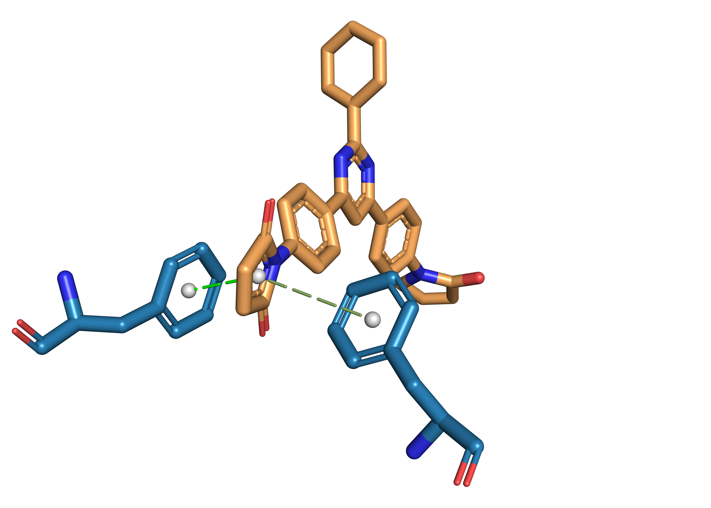
        > <span style="color: #246F9E">Protein residues</span>, <span style="color: #C7894C">ligand</span>; <span style="color: #6C8C4C">T-shaped π-stacking</span>, <span style="color: #00F800">parallel π-stacking</span>.
  * Visualize in **LigPlot+**.
    > **LigPot+** is a structual biology software for 2D visualization of protein-ligand interactions.
  
    > You may acquire academic license for and download **LigPlot+** on [this webpage](https://www.ebi.ac.uk/thornton-srv/software/LigPlus/).
    * In the last **PyMol** session loaded from the [`pse` file](./Results/Interactions/STL592018_COMPLEX_PROTEIN_UNL_L_1.pse), save the session as a [`pdb` file](./Results/Interactions/RBP4.interactions.ligplot+.input.pdb) as input into **LigPlot+**;
      * Go to `file` → `Export Molecule`;
      * Select `PDB` in `Save as Type` module, and click `Write CONECT records for all bonds`;
      * Save `pdb` to appointed directory.
    * Open **LigPlot+** and set default runtime parameters (loosened to search for more potential interactions);
      * Hydrogen-bond calculation parameters;
        * Maximum H-A distance: 3.10 Å;
        * Maximum D-A distance: 3.80 Å.
      * Non-bonded contact parameters.
        * Minimum contact distance: 3.75 Å;
        * Maximum contact distance: 4.75 Å.
    * Load from the [`pdb` file](./Results/Interactions/RBP4.interactions.ligplot+.input.pdb) and export as [`ps` image](./Processed/Interactions/interactions.7.ps), then convert [`ps`](./Processed/Interactions/interactions.7.ps) to [`png`](./Processed/Interactions/interactions.7.png).
      * [Fig.3g](./Processed/Interactions/interactions.7.png) shows all interactions, though slightly different from the results acquired from previous analysis as **LigPlot+** tends to compute interactions by itself.
    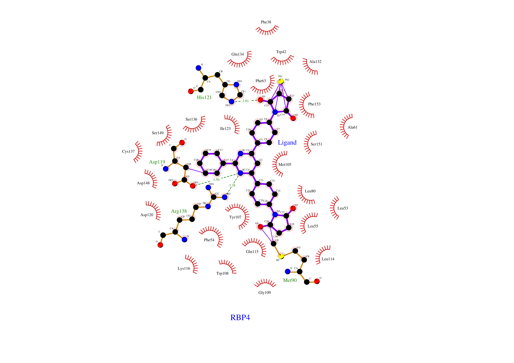

        > Green dashed line: hydrogen bonds; red eyelashes:	hydrophobic contact; yellow ball and converged purple lines: π-stacking.
* **Structure optimization based on predicted interactions.**
  * Prediction based on personal knowledge;
    * Summarized features of docking;
      * Main interactions are **hydrophobic interactions** between the aromatic rings on the ligand and residues;
      * Others include a few **weak hydrogen bonds** and **π-stackings**.
    * Plausible modifications to enhance **affinity**;
      > **Affinity** refers primarily to the binding strength of the ligand.
      * **Hydrophobic interactions** are essentially saturated;
      * **Hydrogen bonds** may be strengthened targeting the predicted sites on the ligand;
   
        * The ligand `O1` atom (the hydroxyl group) in [Fig.3g](./Processed/Interactions/interactions.7.png) is a proton donor for the `NE2` atom in residue **His121**, and it could be strengthened if the `O1` atom is subtituted with a **carboxyl group** (`-COOH`), which might have more bonding sites (potentially with **His121** `ND1`), better bonding angles and shorter distance;
        * The ligand `C18` atom in [Fig.3g](./Processed/Interactions/interactions.7.png) is close to both **Asp119** `OD1` and **Arg138** `NH1`, while `C19` is close to **Asp119** `O`, and hydrogen bonds might be created with the following methods;
          * Subtituting `C18` with a **nitrogen** atom that potentially creates hydrogen bond with **Asp119** `OD1`;
          * Adding a **hydroxyl** group (`-OH`) to `C18` that potentially creates hydrogen bonds with both **Asp119** `OD1` and **Arg138** `NH1`;
          * Adding a **hydroxyl** group (`-OH`) or **amino** group (`-NH2`) to `C19` that potentially creates hydrogen bond with **Asp119** `O`.
      * **π-stackings** may be strengthened targeting the predicted sites on the ligand.
        * In [Fig.3f](./Processed/Interactions/interactions.6.png), the left 5-carbon ring is the main actor in π-stacking;
      
        * Increasing **π cloud density** of the ring could strengthen the interaction, and we can achieve this by adding an **electron-donating group** at the ring.
          * *e.g.*, `-OMe` or `-Me`.
    * Plausible modifications to enhance **selectivity**;
      > **Selectivity** means that the ligand will bind specifically to RBP4, not other proteins alike.
      * Run `BLAST` to find unique residues in RBP4 binding sites;
        * Find homologous proteins in *homo sapiens*;
          > [**BLAST**](https://blast.ncbi.nlm.nih.gov/Blast.cgi) is an algorithm that searches for all homologous or similar sequences with the input in a reference database. [blastp](https://blast.ncbi.nlm.nih.gov/Blast.cgi?PAGE=Proteins&PROGRAM=blastp) means [**BLAST**](https://blast.ncbi.nlm.nih.gov/Blast.cgi) for proteins.
          * Input UniProt ID [P02753](https://www.uniprot.org/uniprotkb/P02753/entry) and run [blastp](https://blast.ncbi.nlm.nih.gov/Blast.cgi?PAGE=Proteins&PROGRAM=blastp);
          * From the output, we can identify 2 homologous proteins with RBP4, accession [AAB32200.1](https://www.ncbi.nlm.nih.gov/protein/AAB32200.1?report=genbank&log$=prottop&blast_rank=9&RID=X7JGN27J016) and [2QOS_C](https://www.ncbi.nlm.nih.gov/protein/2QOS_C?report=genbank&log$=prottop&blast_rank=11&RID=X7JGN27J016).
        * Align all homologous proteins with [COBALT](https://blast.ncbi.nlm.nih.gov/tools/cobalt);
          > [**COBALT**](https://blast.ncbi.nlm.nih.gov/tools/cobalt), or Constraint-based Multiple Alignment Tool, is an alignment algorithm that supports **structure- or function-constrained** multiple alignment analysis.
          * Input 3 accessions: AAB32200.1, 2QOS_C, P02753 (RBP4);
          * Download output [`fa`](./Results/Interactions/alignment.fa) and visualized [`pdf`](./Results/Interactions/alignment.pdf) files.

            ```
            >gb|AAB32200.1| apolipoprotein D, apoD [human, plasma, Peptide, 246 aa] [Homo sapiens]
            ----------------QAFHLGKCPNPPVQENFDVNKYLGRWYEI-EKIPTTFENGRCIQ
            ANYSLMENGKIKVL--NQELRADGTVNQIEGEATPVNLTEPAKLEVKF---SWFMPSA--
            PYWILATDYENYALVYSCTCII--QLFHVDFAWILARNPN-LPPETVDSLKNILTSNNID
            VKKMTVTDQ-VNCPKLSQAKEPCVESLVSQYFQTVTDYGKDLMEKVKSPELQAEAKSYFE
            KSKEQLTPLIKKAGTELVNFLSYFVELGTQPATQ
            >pdb|2QOS|C Chain C, Complement component 8, gamma polypeptide [Homo sapiens]
            --------------------ASPISTIQPKANFDAQQFAGTWLLV-AVGSAARFLQEQGH
            RAEATTLHVAPQGTAMAVSTFRKLDGICWQVRQLYGDTGVLGRFLLQARG-----ARGAV
            HVVVAETDYQSFAVLYLERAGQL-------SVKLYARSLP-VSDSVLSGFEQRVQEAHLT
            EDQIFYFPKYGFCEAADQFHVLDEVRR---------------------------------
            ----------------------------------
            >sp|P02753.3| RecName: Full=Retinol-binding protein 4; AltName: Full=Plasma retinol-binding protein; Short=PRBP; Short=RBP; Contains: RecName: Full=Plasma retinol-binding protein(1-182); Contains: RecName: Full=Plasma retinol-binding protein(1-181); Contains: RecName: Full=Plasma retinol-binding protein(1-179); Contains: RecName: Full=Plasma retinol-binding protein(1-176); Flags: Precursor [Homo sapiens]
            MKWVWALLLLAALGSGRAERDCRVSSFRVKENFDKARFSGTWYAMAKKDPEGLFLQDNIV
            AEFSVDETGQMSATAKGRVRLLNNWDVCADMVGTFTDTEDPAKFKMKYWGVASFLQKGND
            DHWIVDTDYDTYAVQYSCRLLNLDGTCADSYSFVFSRDPNGLPPEAQKIVRQRQEELCLA
            RQYRLIVHN-GYCDGRSERNLL--------------------------------------
            ----------------------------------
            ```
        * Create and run [`R` script](./Scripts/Interactions/alignment.unique.R) to identify unique residues that form protein-ligand interactions.
          > You can download **[RStudio](https://posit.co/download/rstudio-desktop)** to code in `R` language. If you're new to `R`, here's a [quick video tutorial](https://b23.tv/Mq2BwVG).
          * Create [`R` script](./Scripts/Interactions/alignment.unique.R);

            ```R
            lines <- readLines("alignment.fa")

            # Extract sequences with gaps preserved
            seq_apod_full <- ""
            seq_c8g_full <- ""
            seq_rbp4_full <- ""

            current_seq <- NULL
            for (line in lines) {
              if (grepl("apolipoprotein D", line, ignore.case = TRUE)) {
                current_seq <- "apod"
              } else if (grepl("2QOS", line, ignore.case = TRUE)) {
                current_seq <- "c8g"
              } else if (grepl("Retinol-binding protein 4", line, ignore.case = TRUE)) {
                current_seq <- "rbp4"
              } else if (!grepl("^>", line) && nchar(trimws(line)) > 0) {
                seq_line <- trimws(line)
                if (current_seq == "apod") {
                  seq_apod_full <- paste0(seq_apod_full, seq_line)
                } else if (current_seq == "c8g") {
                  seq_c8g_full <- paste0(seq_c8g_full, seq_line)
                } else if (current_seq == "rbp4") {
                  seq_rbp4_full <- paste0(seq_rbp4_full, seq_line)
                }
              }
            }

            # Split into characters (including gaps)
            apod_vec <- strsplit(seq_apod_full, "")[[1]]
            c8g_vec <- strsplit(seq_c8g_full, "")[[1]]
            rbp4_vec <- strsplit(seq_rbp4_full, "")[[1]]

            # Get RBP4 sequence without gaps (for position reference)
            rbp4_no_gap <- rbp4_vec[rbp4_vec != "-"]
            rbp4_seq <- paste(rbp4_no_gap, collapse = "")

            cat("\n=== RBP4 SEQUENCE (no gaps) ===\n")
            cat(rbp4_seq, "\n")
            cat(paste0("Length: ", nchar(rbp4_seq), "\n\n"))

            # LigPlot+ interaction residues (mature numbering)
            interaction_ligplot <- c(42, 54, 55, 63, 80, 107, 114, 115, 119, 134, 136, 138, 153)

            # Convert to original sequence numbering (LigPlot+ + 1)
            interaction_positions <- interaction_ligplot + 1

            # Function to classify amino acid properties
            get_property <- function(aa) {
              hydrophobic <- c("A", "V", "L", "I", "M", "F", "W", "Y", "P", "G")
              positive <- c("R", "K", "H")
              negative <- c("D", "E")
              polar <- c("S", "T", "N", "Q", "C")
              
              if (aa %in% hydrophobic) return("hydrophobic")
              else if (aa %in% positive) return("positive")
              else if (aa %in% negative) return("negative")
              else if (aa %in% polar) return("polar")
              else return("unknown")
            }

            # Find alignment positions for each interaction residue
            results <- data.frame()

            for (pos in interaction_positions) {
              # Get the actual amino acid at this position in RBP4 (no-gap sequence)
              if (pos > nchar(rbp4_seq)) {
                next
              }
              rbp4_aa <- substr(rbp4_seq, pos, pos)
              
              # Find where this position is in the alignment (accounting for gaps)
              non_gap_count <- 0
              align_idx <- NA
              for (i in 1:length(rbp4_vec)) {
                if (rbp4_vec[i] != "-") {
                  non_gap_count <- non_gap_count + 1
                  if (non_gap_count == pos) {
                    align_idx <- i
                    break
                  }
                }
              }
              
              if (is.na(align_idx)) {
                next
              }
              
              apod_aa <- ifelse(apod_vec[align_idx] == "-", "gap", apod_vec[align_idx])
              c8g_aa <- ifelse(c8g_vec[align_idx] == "-", "gap", c8g_vec[align_idx])
              
              rbp4_prop <- get_property(rbp4_aa)
              apod_prop <- ifelse(apod_aa == "gap", "gap", get_property(apod_aa))
              c8g_prop <- ifelse(c8g_aa == "gap", "gap", get_property(c8g_aa))
              
              # Calculate uniqueness score
              score <- 0
              if (rbp4_aa != apod_aa) score <- score + 1
              if (rbp4_aa != c8g_aa) score <- score + 1
              if (rbp4_prop != apod_prop) score <- score + 1
              if (rbp4_prop != c8g_prop) score <- score + 1
              if (apod_prop == c8g_prop & rbp4_prop != apod_prop) score <- score + 1
              
              # Find original LigPlot+ number (pos - 1)
              ligplot_num <- pos - 1
              
              results <- rbind(results, data.frame(
                Num = ligplot_num,
                Original_Num = pos,
                RBP4 = rbp4_aa,
                RBP4_Prop = rbp4_prop,
                APOD = apod_aa,
                APOD_Prop = apod_prop,
                C8G = c8g_aa,
                C8G_Prop = c8g_prop,
                Score = score
              ))
            }

            # Sort by score descending
            results <- results[order(-results$Score), ][1:5,]

            cat("\n=== INTERACTION RESIDUES SORTED BY UNIQUENESS SCORE ===\n")
            print(results)
            ```
          * Run [`R` script](./Scripts/Interactions/alignment.unique.R).
            > Note that the original index starts from `1` while the index applied by PLIP starts from `0`.

            ```R
            r$> source("alignment.unique.R")
            ```

            ```
            === RBP4 SEQUENCE (no gaps) ===
            MKWVWALLLLAALGSGRAERDCRVSSFRVKENFDKARFSGTWYAMAKKDPEGLFLQDNIVAEFSVDETGQMSATAKGRVRLLNNWDVCADMVGTFTDTEDPAKFKMKYWGVASFLQKGNDDHWIVDTDYDTYAVQYSCRLLNLDGTCADSYSFVFSRDPNGLPPEAQKIVRQRQEELCLARQYRLIVHNGYCDGRSERNLL 
            Length: 201


            === INTERACTION RESIDUES SORTED BY UNIQUENESS SCORE ===
              Num Original_Num RBP4   RBP4_Prop APOD   APOD_Prop C8G    C8G_Prop Score
            8  115          116    Q       polar    P hydrophobic   A hydrophobic     5
            10 134          135    Q       polar    V hydrophobic   L hydrophobic     5
            9  119          120    D    negative  gap         gap   V hydrophobic     4
            5   80           81    L hydrophobic    R    positive   F hydrophobic     3
            7  114          115    L hydrophobic    M hydrophobic gap         gap     3
            ```
      * From the output, we can see that **Asp119** is a critically unique residue involved in interactions.
        * Therefore, designing polar interactions with **Asp119** is a reasonable modification to enhance **selectivity**;
        * We may consider adding an **amino** group (`-NH2`) to ligand `C19` that potentially creates hydrogen bond with **Asp119** `O`.
  * Prediction based on computer analysis.
    * [**AMBER MD**](https://ambermd.org/index.php);
      > This software is for water molecule binding analysis. It can determine whether the interaction of a water molecule and a residue is stable or not. If the binding energy is low, we may modify the ligand to interact targeting this residue to enhance stability.

      > Please take note that running an MD analysis is extremely time-consuming, sometimes lasting for days. If you insist running MD, please ensure that you don't shut down your computer during analysis and be patient. An alternative, much faster option is **[HydraMap](https://pubs.acs.org/doi/full/10.1021/acs.jcim.3c00408)**, which we will elaborate on later but will not run.
      * Install **ambertools** and prepare environment in `linux`;
        > The `pdb` file we use is [RBP4.str.predict.pdb](./Results/Pocket/RBP4.str.predict.pdb).

          ```bash
          # Install ambertools
          $ conda install -c https://mirrors.tuna.tsinghua.edu.cn/anaconda/cloud/conda-forge/ ambertools=24

          # Make working directory and move the pdb file into it
          $ mkdir ~/MD && cd ~/MD
          $ mv <path_to_pdb_file> .

          # Create bash scripts for running MD
          $ touch run_md.sh monitor.sh
          # These scripts can be edited via vim later
          ```
      * Edit 2 `bash` scripts;
        * **[run_md.sh](./Scripts/Interactions/run_md.sh)** is the script for running MD;

          ```bash
          #!/bin/bash
          # GIST analysis pipeline for RBP4 - runs with sander (AmberTools)

          set -e  # exit on error

          # Log file
          LOG="md_pipeline.log"
          exec > >(tee -a "$LOG") 2>&1

          echo "=========================================="
          echo "Starting MD pipeline at $(date)"
          echo "=========================================="

          # Check if PDB exists
          if [ ! -f "RBP4.str.predict.pdb" ]; then
              echo "ERROR: RBP4.str.predict.pdb not found in current directory"
              exit 1
          fi

          # Step 1: tleap
          echo ""
          echo "[Step 1] Running tleap..."
          cat > leap.in << 'EOFLEAP'
          source leaprc.protein.ff14SB
          source leaprc.water.tip3p
          prot = loadpdb RBP4.str.predict.pdb
          solvateOct prot TIP3PBOX 10.0
          addIons prot Na+ 0
          saveamberparm prot rbp4.prmtop rbp4.inpcrd
          quit
          EOFLEAP
          tleap -f leap.in > leap.out 2>&1
          if [ $? -ne 0 ]; then
              echo "ERROR: tleap failed. Check leap.out"
              exit 1
          fi
          echo "tleap completed successfully"

          Step 2: Minimization
          echo ""
          echo "[Step 2] Running minimization (1000 steps)..."
          cat > min.in << 'EOFM'
          Minimization
          &cntrl
            imin=1, maxcyc=1000, ncyc=500,
            ntb=1, cut=10.0,
            ntpr=100
          /
          EOFM
          sander -O -i min.in -o min.out -p rbp4.prmtop -c rbp4.inpcrd -r min.rst
          if [ $? -ne 0 ]; then
              echo "ERROR: Minimization failed. Check min.out"
              exit 1
          fi
          echo "Minimization completed"

          # Step 3: Heating (NVT) - modified parameters
          echo ""
          echo "[Step 3] Running heating (NVT, 100 ps, gentle ramp)..."
          cat > heat.in << 'EOFH'
          Heating NVT with temperature ramp
          &cntrl
            irest=0, ntx=1,
            nstlim=100000, dt=0.001,
            ntt=3, gamma_ln=2.0, temp0=300.0,
            ntb=1, cut=10.0,
            ntr=1, restraint_wt=25.0,
            restraintmask="!:WAT & !@H=",
            ntpr=500, ntwx=5000,
            nmropt=1
          /
          &wt type='TEMP0', istep1=0, istep2=100000, value1=0.0, value2=300.0 /
          &wt type='END' /
          EOFH

          sander -O -i heat.in -o heat.out -p rbp4.prmtop -c min.rst -r heat.rst -ref min.rst
          if [ $? -ne 0 ]; then
              echo "ERROR: Heating failed. Check heat.out"
              exit 1
          fi
          echo "Heating completed"

          # Step 4: Equilibration (NPT) - modified parameters (dt=0.002, nstlim=50000 for 100 ps)
          echo ""
          echo "[Step 4] Running equilibration (NPT, 100 ps)..."
          cat > equil.in << 'EOFE'
          Equilibration NPT
          &cntrl
            irest=1, ntx=5,
            nstlim=50000, dt=0.002,
            ntt=3, gamma_ln=2.0, temp0=300.0,
            ntb=2, ntp=1, pres0=1.0, taup=1.0,
            cut=10.0,
            ntr=1, restraint_wt=25.0,
            restraintmask="!:WAT & !@H=",
            ntpr=500, ntwx=5000
          /
          EOFE

          sander -O -i equil.in -o equil.out -p rbp4.prmtop -c heat.rst -r equil.rst -ref heat.rst
          if [ $? -ne 0 ]; then
              echo "ERROR: Equilibration failed. Check equil.out"
              exit 1
          fi
          echo "Equilibration completed"

          # Step 5: Production MD (5 ns) - dt=0.002, nstlim=2500000
          echo ""
          echo "[Step 5] Running production MD (5 ns, 2.5M steps)..."
          cat > md.in << 'EOFM'
          Production MD 5 ns
          &cntrl
            irest=1, ntx=5,
            nstlim=2500000, dt=0.002,
            ntt=3, gamma_ln=2.0, temp0=300.0,
            ntb=2, ntp=1, pres0=1.0, taup=1.0,
            cut=10.0,
            ntwx=5000, ntpr=500, ntwr=5000
          /
          EOFM

          sander -O -i md.in -o md.out -p rbp4.prmtop -c equil.rst -r md.rst -x mdcrd.nc
          if [ $? -ne 0 ]; then
              echo "ERROR: Production MD failed. Check md.out"
              exit 1
          fi
          echo "Production MD completed"

          # Step 6: Calculate pocket center (optional, for GIST)
          echo ""
          echo "[Step 6] Calculating pocket center from aromatic residues..."

          python3 << 'EOFP'
          import sys
          with open("RBP4.str.predict.pdb", "r") as f:
              coords = []
              for line in f:
                  if line.startswith("ATOM") and line[12:16].strip() in ["PHE","TRP","TYR"]:
                      try:
                          x = float(line[30:38]); y = float(line[38:46]); z = float(line[46:54])
                          coords.append([x,y,z])
                      except:
                          pass
              if coords:
                  cx = sum(c[0] for c in coords)/len(coords)
                  cy = sum(c[1] for c in coords)/len(coords)
                  cz = sum(c[2] for c in coords)/len(coords)
                  with open("pocket_center.txt", "w") as out:
                      out.write(f"Pocket center: {cx:.3f} {cy:.3f} {cz:.3f}\n")
                  print(f"Pocket center calculated: {cx:.3f} {cy:.3f} {cz:.3f}")
              else:
                  print("WARNING: Could not calculate pocket center - no aromatic residues found")
                  with open("pocket_center.txt", "w") as out:
                      out.write("Pocket center: 0.000 0.000 0.000\n")
          EOFP

          echo ""
          echo "=========================================="
          echo "MD PIPELINE COMPLETED SUCCESSFULLY at $(date)"
          echo "=========================================="
          echo ""
          echo "Generated files:"
          ls -lh rbp4.prmtop rbp4.inpcrd min.rst heat.rst equil.rst md.rst mdcrd.nc pocket_center.txt 2>/dev/null
          echo ""
          ```

        * **[monitor.sh](./Scripts/Interactions/monitor.sh)** is the script for monitoring the process in case of errors.

          ```bash
          #!/bin/bash
          while true; do
              if ! pgrep -f "run_md.sh" > /dev/null; then
                  echo "MD job has stopped at $(date)" >> monitor.log
                  echo "Last 20 lines of run.log:" >> monitor.log
                  tail -20 run.log >> monitor.log
                  break
              fi
              sleep 900  # Check every 15min
          done
          ```
      * Run analysis;
        > The reason we use `nohup` command to run these scripts is that the analysis might take days, and `nohup` ensures the project continues to run even if your computer is in sleep mode.

        ```bash
        # Run run_md.sh and record everything into run.log
        $ nohup bash run_md.sh > run.log 2>&1 &

        # Run monitor.sh and record everything into monitor.out
        $ nohup bash monitor.sh > monitor.out 2>&1 &

        # Open 2 terminals respectively and check timely updates on analysis
        $ tail -f run.log
        $ tail -f monitor.out
        ```
      * Acquire results and reach conclusions;
      * Alternative solution: **[HydraMap v.2](https://pubs.acs.org/doi/full/10.1021/acs.jcim.3c00408)**.
        * Download the **[HydraMap v.2](https://pubs.acs.org/doi/full/10.1021/acs.jcim.3c00408)** program, test data and test results [here](https://pubs.acs.org/doi/suppl/10.1021/acs.jcim.3c00408/suppl_file/ci3c00408_si_002.zip) or directly get the [`zip` file](./Supplementary/Interactions/HydraMap.zip);
        * Prepare ligand file through **PyMol**;
          * In the last PyMol session (loaded from [docked `pdb` file](./Results/Screening/STL592018.docked.pdb)), run these commands;

            ```bash
            PyMOL> save ~\ligand.mol2, resn UNL
            ```
        * Run these commands in `linux` and acquire results.

          ```bash
          # Unzip the zip file
          $ unzip <path_to_zip_file>

          # Prepare working directory
          $ cd HydraMap/Program
          $ mv <path_to_RBP4.str.predict.pdb_file> <path_to_ligand.mol2_file> .

          # Run MD (refer to HydraMap/README.txt for help)
          $ ./wsitem RBP4.str.predict.pdb ligand.mol2 holo 3.0 3.0 2.0 10
          $ ./getwat RBP4.str.predict.pdb ligand.mol2 RBP4.str.predict_holo_ws.pdb 5.0
          $ ./wnmin RBP4.str.predict.pdb RBP4.str.predict_holo_min-5A.pdb 100
          $ ./wnmin2 RBP4.str.predict.pdb ligand.mol2 RBP4.str.predict_holo_min-5A.pdb 100
          ```
    * [**RING**](https://ring.biocomputingup.it/).
      > This web server is for `RIN` analysis. Abbreviated for Residue Interaction Network Generator. It is commonly acknowledged that the more involved a residue is in interactions within the protein, the more likely it's a critical residue in conformational changes, ligand recognition and signaling transduction.
      * Input RBP4 UniProt ID [P02753](https://www.uniprot.org/uniprotkb/P02753/entry) and run [**RING**](https://ring.biocomputingup.it/) analysis;
      * Output results can be seen in [network `json` format](./Results/Interactions/P02753.json), [RINGNode `cif` format](./Results/Interactions/P02753.cif_ringNodes) or directly on [**webpage**](https://ring.biocomputingup.it/job/0d2073bf-5dba-4489-804f-a19980fd941c).
        * The first column in [RINGNode `cif` file](./Results/Interactions/P02753.cif_ringNodes) lists all residues, and the corresponding **Degree** column lists how many interactions they are involved in;
        * In `linux`, run the following command;

          ```bash
          $ awk -F'\t' '{print $1 "\t" $7}' P02753.cif_ringNodes |\
          > head -5 | column -t
          NodeId     Degree
          A:1:_:MET  1
          A:2:_:LYS  2
          A:3:_:TRP  3
          A:4:_:VAL  3
          ```
        * Create [`R` script](./Scripts/Interactions/RINGNodes.sort.R) to analyze this [`cif_ringNodes`file](./Results/Interactions/P02753.cif_ringNodes);

          ```R
          # Load the node table
          df <- read.table("P02753.cif_ringNodes", header = TRUE, sep = "\t", fill = TRUE)

          # Residues of interest
          res <- c(42, 54, 55, 63, 80, 107, 114, 115, 119, 134, 136, 138, 153)
          ring_res <- res + 1

          # Subset
          df_sub <- df[df$Position %in% ring_res, c("Position", "Residue", "Degree")]

          # Sort by Degree descending
          df_sorted <- df_sub[order(-df_sub$Degree), ]

          # Switch to original indexes
          df_sorted$Position <- df_sorted$Position - 1

          # Top 7
          head(df_sorted, 7)
          ```
        * Run the [script](./Scripts/Interactions/RINGNodes.sort.R) and reach conclusion.

          ```R
          r$> source("RINGNodes.sort.R")
              Position Residue Degree
          108      107     TYR     10
          135      134     GLN     10
          139      138     ARG     10
          154      153     VAL     10
          137      136     SER      9
          43        42     TYR      8
          120      119     ASP      8
          ```
          * From the result, we can see that these residues are interaction centers among pocket residues, and by cross-referring with both LigPlot+ and PLIP results, we can infer that ligand modifications targeting the following residues will be of most significance.
            * **Arg138**;
              * Could be achieved by adding hydroxyl group to ligand `C18` or `C16`.
            * **Asp119**;
              * Could be achieved by adding hydroxyl/amino group to ligand `C19`, or substituting `C18` with nitrogen.
            * **Ser136**.
              * Could be achieved by adding carboxyl/amide group to ligand `C19`.

---
### T6
> Experimental strategies.

* **Assay 1: Fluorescence-Based Retinol Competition Assay**
    * What it measures;
        * Determines if selected compound (`STL592018`) **competes** with RBP4's natural ligand, retinol (vitamin A), for binding to the same pocket.
    * Principle;
      * RBP4 has **a natural fluorescence signal at Trp107** inside its pocket;
      * When retinol binds, it absorbs this signal (quenching), causing fluorescence to decrease;
      * If the compound binds to the same pocket, it will also cause a measurable change in this signal.
    * Short protocol;
        * 1. Purify RBP4 protein;
        * 2. Add a fixed concentration of retinol to RBP4 in a 96-well plate;
        * 3. Add increasing concentrations of STL592018, from 0.1 nM to 100 µM, to different wells;
        * 4. Measure fluorescence using a plate reader (excitation at 280 nm, emission at 340 nm) targeting Trp;
        * 5. Plot fluorescence intensity vs. compound concentration to calculate **IC₅₀** (the concentration needed to displace 50% of bound retinol).
    * Key Readouts.
        * **IC₅₀ (in nM or µM):** A lower IC₅₀ indicates stronger binding competition. The natural ligand retinol has an IC₅₀ around 100 nM in similar assays[^5].
* **Assay 2: Surface Plasmon Resonance (SPR) for Direct Binding Kinetics**
    * What it measures;
      * Provides precise, real-time measurements of binding kinetics.
        * How fast the compound binds ($k_{on}$) and how long it stays bound ($k_{off}$);
        * How strong it binds ($K_D$).
    * Principle;
      * Immobilized RBP4 protein molecules on a **chip** are fulshed with compound solution;
      * When the compound binds, it changes the **refractive index** near the chip surface, generating a signal[^6];
      * By measuring how this signal changes over time at different concentrations, we can acquire the precise binding parameters.
    * Short protocol;
        * 1. Immobilize RBP4 on a Biacore **sensor chip** CM5 using an amine coupling kit;
        * 2. Prepare the compound at different concentrations (*e.g.*, 1 nM to 100 µM);
        * 3. Inject each concentration over the chip (**association phase**), then flow buffer alone (**dissociation phase**);
        * 4. Regenerate the chip with a mild buffer (*e.g.*, Glycine-HCl, pH 2.5) to remove remaining compound between injections;
        * 5. Use the data to calculate kinetic parameters.
    * Key Readouts;
        * **$K_D$ (nM or µM):** The equilibrium dissociation constant: a lower $K_D$ means tighter binding;
        * **$k_{off}$ (s⁻¹):** The dissociation rate: in clinical terms, a slow dissociation rate (small $k_{off}$) is often more important for **long-lasting** effects.
* **Assay 3: Cellular Retinol Delivery Assay Using STRA6-Expressing Cells**
    * What it measures;
      * Assesses whether the compound affects the **physiological function** of RBP4 (its ability to deliver retinol into cells via the STRA6 receptor).
    * Principle[^7];
      * Cells engineered to express the STRA6 receptor;
      * Add RBP4 loaded with retinol, along with the compound;
      * If the compound binds the pocket, it should hamper retinol delivery, which can be measured by quantifying how much retinol gets inside the cells.
    * Short protocol;
        * 1. Culture HEK293 cells that stably express human STRA6 and the enzyme LRAT, which traps retinol inside the cell;
        * 2. Load purified RBP4 with retinol;
        * 3. Pre-incubate the loaded RBP4 with STL592018 at various concentrations (0, 10 nM, 1 µM, 10 µM);
        * 4. Incubate the mixture with the cells;
        * 5. Wash the cells thoroughly to remove unbound RBP4 and the compound;
        * 6. Measure intracellular retinol content using **HPLC**, **flow cytometry** (if using a fluorescent retinol analog), or **spectrophotometry**.
    * Key Readouts;
        * **Cellular retinol uptake (pmol/10⁶ cells):** Quantifies how much retinol enters the cell, thereby reflecting the effect of compound binding.

[^1]: [Williamson, K. A., et al. Mutations in RBP4 cause an autosomal dominant form of microphthalmia. *Am. J. Hum. Genet.* 105(3): 566-577, 2019.](https://doi.org/10.1016/j.ajhg.2019.07.010)
[^2]: [Verma, A., et al. Clinical spectrum of RBP4-related microphthalmia. *Ophthalmology*. 128(4): 612-619, 2021.](https://doi.org/10.1016/j.ophtha.2020.09.028)
[^3]: [Chou, C. M., et al. RBP4 retinol-binding protein. *Mol. Vis.* 26: 412-425, 2020.](https://doi.org/10.1007/s00412-020-00735-w)
[^4]: [Chou, C. M., et al. Biochemical basis for dominant inheritance, variable penetrance, and maternal effects in RBP4 congenital eye disease. *Cell.* 161(3): 634-646, 2015.](https://doi.org/10.1016/j.cell.2015.03.006)
[^5]: [Sharif, O., et al. Time-resolved fluorescence resonance energy transfer and surface plasmon resonance-based assays for retinoid and transthyretin binding to retinol-binding protein 4. *Analytical Biochemistry.* 393(1): 73-80, 2009.](https://doi.org/10.1016/j.ab.2009.05.038)
[^6]: [Liedberg, B., Nylander, C., & Lundström, I. Surface plasmon resonance for gas detection and biosensing. *Sensors and Actuators.* 4: 299-304, 1983.](https://doi.org/10.1016/0250-6874(83)85036-7)
[^7]: [Isken, A., et al. RBP4 disrupts vitamin A uptake homeostasis in a STRA6-deficient animal model for Matthew-Wood syndrome. *Cell Metabolism.* 7(3): 258-268, 2008.](https://doi.org/10.1016/j.cmet.2007.12.003)