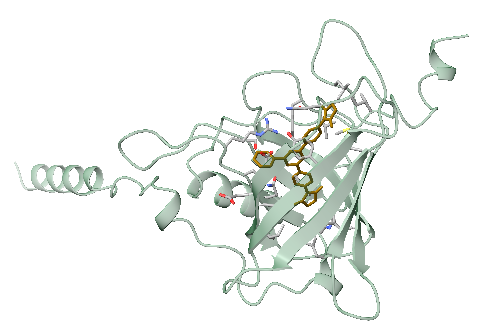

# Homework 4

> An answer `md` file for homework 4 in course *Biochemistry* by 黄悉然.

> Quickly direct to [T1](#t1), [T2](#t2), [T3](#t3), [T4](#t4), [T5](#t5) or [T6](#t6).
---
### T1
> Select disease and protein of interest.
* **Selected disease and protein;**
  * Disease: [**MCOPCB10**](https://omim.org/entry/616428), autosomal dominant **microphthalmia/coloboma**-10 (MIM ID: [#616428](https://omim.org/entry/616428));
    * **MCOPCB10** is an **AD** genetic disease caused by mutations in the **RBP4** gene[^1];
    * Manifested as ocular developmental disorders including microphthalmia, anophthalmia, and/or coloboma[^2];
    * Caused by **heterozygous mutation** in [**RBP4** gene](https://www.genenames.org/data/gene-symbol-report/#!/hgnc_id/9922) (MIM ID: [180250](https://omim.org/entry/180250); HGNC ID: [9922](https://www.genenames.org/data/gene-symbol-report/#!/hgnc_id/9922); Ensembl ID: [ENSG00000138207](https://www.ensembl.org/Homo_sapiens/Gene/Summary?g=ENSG00000138207); UCSC ID: [uc003vng.3](http://genome.cse.ucsc.edu/cgi-bin/hgGene?org=Human&hgg_chrom=none&hgg_type=knownGene&hgg_gene=uc003vng.3))[^3].
      * **RBP4**, retinol binding protein 4;
      * Encodes protein **RBP4**, a key protein in MCOPCB10 pathology.
  * Protein: [**RBP4**](https://www.uniprot.org/uniprotkb/P02753/entry), retinol-binding protein 4 (UniProt ID: [P02753](https://www.uniprot.org/uniprotkb/P02753/entry)).
    * **RBP4**, *homo sapiens*, encoded by gene RBP4;
    * Function (see reference on [UniProt](https://www.uniprot.org/uniprotkb/P02753/entry));
      * Transports **retinol (vitamin A)** from **liver** to peripheral tissues, particularly to the **retina** for visual cycle maintenance;
        * Binds retinol with high affinity ($K_d \in (0.1,1) \text{nM}$) within its **hydrophobic β-barrel pocket**;
        * Another site of RBP4 binds to receptor **[STRA6](https://www.uniprot.org/uniprotkb/Q9BX79/entry)** to transfer retinol.
      * Due to the small size of RBP4, it binds with TTR to form a tetramer to prevent its loss through renal filtration;
      * Also relevant with Type II diabetes, obesity, etc.
    * Ligand: [**retinol (vitamin A)**](https://pubchem.ncbi.nlm.nih.gov/compound/445354)

      ```smiles
      CC1=C(C(CCC1)(C)C)/C=C/C(=C/C=C/C(=C/CO)/C)/C
      ```
    * Family: **Lipocalin** family;
    * Length: 201 aa (amino acids); MW: ~21 kDa;
    * Pathology and variants[^4].
      * Pathological variants: [**A73T**](https://web.expasy.org/variant_pages/VAR_073856.html) and [**A75T**](https://web.expasy.org/variant_pages/VAR_073857.html);
      * Molecular pathology:
        * Site **73** and **75** are located in the **hydrophobic β-barrel pocket**, binding pocket of retinol;
        * These mutations from hydrophobic residues to hydrophilic ones are unfavorable for retinol binding and conformation stability;
        * As a result, the variants' binding efficiency with retinol is compromised, while the conformational changes increase their affinity with STRA6.
      * Physiological pathology
        * The mutated proteins prevail in competition with normal proteins to bind with receptor STRA6 yet deliver less retinol, making the mutation a dominant one;
        * Lack of retinol in eye tissues result in a disorder of eye formation.
* **Downloaded relevant data.**
  * All source data are stored in folder [**Source Data**](./Source%20Data/) under parent folder;

    [Source Data](./Source%20Data/)
    ├── [RBP4.seq.fasta](./Source%20Data/RBP4.seq.fasta)
    └── [RBP4.str.pdb](./Source%20Data/RBP4.str.pdb)
  * Including sequence in [`fasta` format](https://rest.uniprot.org/uniprotkb/P02753.fasta) and [`pdb` structure with ligand](https://www.rcsb.org/structure/1RBP); click to view web source;
    > Note that the [`fasta` file](./Source%20Data/RBP4.seq.fasta) is the whole sequence with signaling peptide, while the downloaded [`pdb` file](./Source%20Data/RBP4.str.pdb) is the mature structure without; the [prediction structure file](./Results/Predict/RBP4_str_predict/seed_2802/predictions/RBP4_str_predict_sample_0.cif) generated in [T2](#t2) is derived from the downloaded whole sequence, making it an immature structure.
  * Check [`fasta` file](./Source%20Data/RBP4.seq.fasta) here.

    ```fasta
    >sp|P02753|RET4_HUMAN Retinol-binding protein 4 OS=Homo sapiens OX=9606 GN=RBP4 PE=1 SV=3
    MKWVWALLLLAALGSGRAERDCRVSSFRVKENFDKARFSGTWYAMAKKDPEGLFLQDNIV
    AEFSVDETGQMSATAKGRVRLLNNWDVCADMVGTFTDTEDPAKFKMKYWGVASFLQKGND
    DHWIVDTDYDTYAVQYSCRLLNLDGTCADSYSFVFSRDPNGLPPEAQKIVRQRQEELCLA
    RQYRLIVHNGYCDGRSERNLL
    ```
---
### T2
> Protein structure prediction.
* **Run prediction on [ProteinX server](https://protenix-server.com/);**
  * Submit the following sequence and set default parameters;

    ```
    MKWVWALLLLAALGSGRAERDCRVSSFRVKENFDKARFSGTWYAMAKKDPEGLFLQDNIVAEFSVDETGQMSATAKRVRLLNNWDVCADMVGTFTDTEDPAKFKMKYWGVASFLQKGNDDHWIVDTDYDTYAVQYSCRLLNLDGTCADSYSFFSRDPNGLPPEAQKIVRQRQEELCLARQYRLIVHNGYCDGRSERNLL
    ```
  * Results are in folder [Predict](./Results/Predict/) under folder [Results](./Results/);
  * Later analysis are mostly based on this `cif` file: [RBP4_str_predict_sample_0.cif](./Results/Predict/RBP4_str_predict/seed_2802/predictions/RBP4_str_predict_sample_0.cif).
* **Operate on `cif` file with ChimeraX**

    ```bash
    # 1. Open file
    open <path_to_cif_file> format mmcif

    # 2. Set basic display arguments
    set bgColor white
    color #1 #366d47ff
    lighting simple

    # 3. Highlight variant sites: 73A and 75A
    select :73,75
    show sel atoms
    style sel ball
    color sel #8B6508

    # 4. Create labels
    label :73 text A73T
    label :75 text A75T
    label height 1.5
    label color #ffd87e

    # 5. Save figure
    select clear
    save <path_to_png_file> width 3000 height 2000 supersample 3
    ```
* **Acquire figures.**
  * [Fig.1a](./Processed/Predict/RBP4.pred.mut.1.png) shows the overall view of the protein, with the α-helix on the left being the unsevered signaling peptide;

  * [Fig.1b](./Processed/Predict/RBP4.pred.mut.2.png) shows the overall view of the protein excluding the signaling peptide and highlighting the β-barrel;

  * [Fig.1c](./Processed/Predict/RBP4.pred.mut.3.png) shows the detailed image of the mutation sites inside the β-barrel.

---
### T3
> Identify most promising binding pocket.

> In this section, RBP4 structure is still based on prediction from [T2](#t2).
* **Preparation;**
  * In the last `chimera` session (from [T2](#t2)), we may use the following command to convert the [`cif` file](./Results/Predict/RBP4_str_predict/seed_2802/predictions/RBP4_str_predict_sample_0.cif) to a [`pdb` file](./Results/Pocket/RBP4.str.predict.pdb); this step is for convenience in later analysis.

    ```bash
    save <path_to_pdb_file> format pdb models #1
    ```
* **Predict promising binding pockets in `linux`;**
  * If you are unfamiliar with operating in `linux` for bioinformatic analysis, watch [this teaching video](https://b23.tv/xMzD6oO) in bilibili to get a quick start;
    * We first need to install `miniconda3` and `mamba`;

      ```bash
      # Change to your working directory
      $ cd <your_working_dir>

      # Install miniconda3
      $ wget -c https://mirrors.tuna.tsinghua.edu.cn/anaconda/miniconda/Miniconda3-latest-Linux-x86_64.sh
      $ bash Miniconda3-latest-Linux-x86_64.sh
      $ source ~/.bashrc
      # If you don't have wget, use apt or yum command lines to install wget

      # Install mamba
      $ conda install -n base mamba -c conda-forge -y
      ```
    * Then we need to move the [`pdb` file](./Results/Pocket/RBP4.str.predict.pdb) to our working directory.
  * Install and run `fpocket` for pocket prediction;

    ```bash
    # Install fpocket
    $ mamba install -c conda-forge fpocket

    # Run fpocket
    $ fpocket -f RBP4.str.predict.pdb
    # Aftercompletion, the results are stored in a directory called RBP4.str.predict_out.
    ```
  * View [results](./Results/Pocket/RBP4.str.predict_out/).
    * Under this folder, there are 2 files that are important;

      [RBP4.str.predict_out](./Results/Pocket/RBP4.str.predict_out/)
      ├── [RBP4.str.predict_info.txt](./Results/Pocket/RBP4.str.predict_out/RBP4.str.predict_info.txt)
      └── [pockets](./Results/Pocket/RBP4.str.predict_out/pockets/)
          └── [pocket1_atm.pdb](./Results/Pocket/RBP4.str.predict_out/pockets/pocket1_atm.pdb)
    * [RBP4.str.predict_info.txt](./Results/Pocket/RBP4.str.predict_out/RBP4.str.predict_info.txt) is a table that lists the credibility (score) of each predicted pocket;
    * [pocket1_atm.pdb](./Results/Pocket/RBP4.str.predict_out/pockets/pocket1_atm.pdb) is a `pdb` file that depicts all atoms predicted to form the most possible pocket among all.
* **Visualization in ChimeraX.**
  * Pipeline;
    * Open files and set basic outlook;

      ```bash
      # Open files
      open <path_to_cif_file> format mmcif
      open <path_to_atm.pdb_file>

      # Set background and basic settings
      set bgColor white
      color #1 #366d47ff
      lighting simple

      hide #2.1 models
      select #2
      color sel #87ceeb
      style sel ball
      ```
    * Visualize pocket;

      ```bash
      # We can show the surface of atoms to visualize the pocket
      show sel surface
      color #2.2 #7cbbbeff
      transparency 70
      ```
    * Determine pocket residues and highlight them;

      ```bash
      # We can determine pocket residues by setting a distance threshold, like 3.5 Å
      select #1 & #2 :<3.5

      # Save information on the pocket residues for later analysis as txt file
      info residues sel saveFile <path_to_txt_file>

      # Highlight selected residues
      show sel atoms
      color sel byatom

      select #1 & ~sel
      color sel lightgrey
      transparency sel 90 target ac
      ```
    * Record spin movies and save figures;
    * Show mutation sites reletive to the pocket.

      ```bash
      # Modify certain outlook
      select #2
      color sel lightgrey target a

      # Highlight mutation sites
      select #1:73,75
      color sel #8B6508

      label :73@ca text A73T
      label :75@ca text A75T
      label height 1.5
      label color #ffd87e
      ```
  * Acquire results.
    * [Fig.2a](./Processed/Pocket/pocket.predict.1.png) and [Mov.2a](./Processed/Pocket/pocket.predict.1.mp4) shows the overview of the pocket; the pocket and pocket atoms are colored in lightblue, with residues within the pocket colored darkgreen;
  

    * [Fig.2b](./Processed/Pocket/pocket.predict.2.png) and [Mov.2b](./Processed/Pocket/pocket.predict.2.mp4) shows the relative position of mutation sites with the predicted pocket; mutation sites are colored in gold;
  

    * [pocket.predict.residues.txt](./Processed/Pocket/pocket.predict.residues.txt) shows all information on predicted residues that constitute the pocket.
      > The column for `index` in this `txt` file equals to a residue's position subtracted by 1. This is because in bioinformatic studies, `index` starts with 0, while position starts with 1.
      * We can analyze this file with the following commands in `linux`;

        ```bash
        $ wc -l pocket.predict.residues.txt
        46 pocket.predict.residues.txt
        # Suggests that this pocket is constituted by 46 residues
        ```
        
        ```bash
        $ awk -F' ' '{print $5}' pocket.predict.residues.txt |\
        > sort | uniq -c | sort -rn
              5 PHE
              5 LYS
              5 ALA
              4 SER
              4 ASP
              3 TYR
              3 MET
              3 LEU
              2 VAL
              2 THR
              2 GLY
              2 GLN
              1 TRP
              1 PRO
              1 ILE
              1 HIS
              1 GLU
              1 ARG
        # Counts all residues sorted by type
        ```
      * We can also create a [`bash` script](./Scripts/Pocket/pocket.predict.residues.count.sh) to separate hydrophobic and hydrophilic residues;
        * [Script](./Scripts/Pocket/pocket.predict.residues.count.sh);

          ```bash
          # Edit script in vim
          vim pocket.predict.residues.count.sh
          ```

          ```bash
          #!/bin/bash
          # Usage: ./pocket.predict.residues.count.sh <count_file> <original_file>
          # Example: ./pocket.predict.residues.count.sh pocket.predict.residues.count.txt pocket.predict.residues.txt

          count_file="$1"
          orig_file="$2"

          # 1. Collect positions for each AA from original file
          awk '
          BEGIN {
              split("GLY,ALA,VAL,LEU,ILE,MET,PHE,TRP,PRO", hydro, ",");
              for (i in hydro) hydrophobic[hydro[i]] = 1;
              split("SER,THR,TYR,ASN,GLN,LYS,ARG,HIS,ASP,GLU", hydrophi, ",");
              for (i in hydrophi) hydrophilic[hydrophi[i]] = 1;
              
              hydro_all = "";
              phil_all = "";
          }
          {
              # Extract residue ID
              match($0, /#1\/A:([0-9]+)/);
              pos = substr($0, RSTART+5, RLENGTH-5);
              aa = $5;
              
              if (aa in hydrophobic) {
                  # Per-residue positions
                  hydro_pos[aa] = hydro_pos[aa] ? hydro_pos[aa] "," pos : pos;
                  hydro_sum[aa]++;
                  # Combined positions
                  hydro_all = hydro_all ? hydro_all "," pos : pos;
              } else if (aa in hydrophilic) {
                  # Per-residue positions
                  phil_pos[aa] = phil_pos[aa] ? phil_pos[aa] "," pos : pos;
                  phil_sum[aa]++;
                  # Combined positions
                  phil_all = phil_all ? phil_all "," pos : pos;
              }
          }
          END {
              # Print
              printf "=== Hydrophobic Combined Positions ===\n";
              printf "%s\n\n", hydro_all;
              
              printf "=== Hydrophobic by Residue Type ===\n";
              for (aa in hydro_pos) {
                  printf "  %s (n=%d): %s\n", aa, hydro_sum[aa], hydro_pos[aa];
              }
              
              printf "\n=== Hydrophilic Combined Positions ===\n";
              printf "%s\n\n", phil_all;
              
              printf "=== Hydrophilic by Residue Type ===\n";
              for (aa in phil_pos) {
                  printf "  %s (n=%d): %s\n", aa, phil_sum[aa], phil_pos[aa];
              }
          }' "$orig_file"

          # 2. Calculate ratios from count file
          awk '
          BEGIN {
              split("GLY,ALA,VAL,LEU,ILE,MET,PHE,TRP,PRO", hydro, ",");
              for (i in hydro) hydrophobic[hydro[i]] = 1;
              split("SER,THR,TYR,ASN,GLN,LYS,ARG,HIS,ASP,GLU", hydrophi, ",");
              for (i in hydrophi) hydrophilic[hydrophi[i]] = 1;
              total_hydrophobic = 0;
              total_hydrophilic = 0;
          }
          {
              if ($2 in hydrophobic) total_hydrophobic += $1;
              else if ($2 in hydrophilic) total_hydrophilic += $1;
          }
          END {
              total = total_hydrophobic + total_hydrophilic;
              if (total > 0) {
                  printf "\n=== Summary ===\n";
                  printf "Hydrophobic: %d (%.2f%%)\n", total_hydrophobic, total_hydrophobic/total*100;
                  printf "Hydrophilic: %d (%.2f%%)\n", total_hydrophilic, total_hydrophilic/total*100;
                  printf "Ratio (Hpho/Hphi): %.2f\n", total_hydrophobic/total_hydrophilic;
              }
          }' "$count_file"
          ```
        * Run [script](./Scripts/Pocket/pocket.predict.residues.count.sh);

          ```bash
          # Alter access to script
          $ chmod 754 pocket.predict.residues.count.sh

          # Prepare input file
          $ awk -F' ' '{print $5}' pocket.predict.residues.txt |\
          > sort | uniq -c | sort -rn > pocket.residues.count.txt
          ```

          ```bash
          # Run
          $ ./pocket.predict.residues.count.sh pocket.predict.residues.count.txt pocket.predict.residues.txt
          === Hydrophobic Combined Positions ===
          44,45,46,50,53,54,55,59,61,63,73,75,78,80,90,91,92,94,105,108,117,152,153

          === Hydrophobic by Residue Type ===
            GLY (n=2): 92,117
            LEU (n=3): 53,55,80
            PRO (n=1): 50
            ILE (n=1): 59
            MET (n=3): 45,90,105
            PHE (n=5): 54,63,94,152,153
            TRP (n=1): 108
            ALA (n=5): 44,46,61,73,75
            VAL (n=2): 78,91

          === Hydrophilic Combined Positions ===
          47,48,49,62,72,74,76,89,93,106,107,115,116,119,120,121,134,135,136,138,149,150,151

          === Hydrophilic by Residue Type ===
            GLN (n=2): 115,134
            THR (n=2): 74,93
            TYR (n=3): 107,135,150
            LYS (n=5): 47,48,76,106,116
            SER (n=4): 72,136,149,151
            ASP (n=4): 49,89,119,120
            HIS (n=1): 121
            GLU (n=1): 62
            ARG (n=1): 138

          === Summary ===
          Hydrophobic: 23 (50.00%)
          Hydrophilic: 23 (50.00%)
          Ratio (Hpho/Hphi): 1.00
          ```
        * With the results above, we may highlight hydrophobic and hydrophilic residues respectively in ChimeraX (within the previous session) and show their relative position to the protein surface (inside or outside the surface).
          * Pipeline;

            ```bash
            # 1. Calculate SASA (an index: the smaller, the deeper a residue is embedded in the protein)
            measure sasa #1 & protein setAttribute true

            # 2. Select hydrophobic/philic residues
            select #1/A:<the_position_vector_of_hydrophobic/philic_residues>
            # This vector is shown in the results from running the bash script
            show sel atoms
            color sel lightgrey target a

            # 3. Single out embedded residues via SASA
            select #1/A:<the_position_vector_of_hydrophobic/philic_residues> ::area<10
            # From this step we can know that 4 hydrophilic and 9 hydrophobic residues can be termed embedded
            color sel #8B6508 target a

            # 4. Save png file
            select clear
            save <path_to_png_file> width 3000 height 2000 supersample 3
            ```
          * Acquire figures.
            * [Fig.2c](./Processed/Pocket/pocket.predict.3.png) shows hydrophobic residues among all pocket residues; embedded residues (9 out of 25) are shown in gold with others shown in lightgrey;
          
            * [Fig.2d](./Processed/Pocket/pocket.predict.4.png) shows hydrophilic residues among all pocket residues; embedded residues (4 out of 25) are shown in gold with others shown in lightgrey;
          
            * These results combined suggests that **the pocket core is more likely hydrophobic**, with the hydrophilic residues mainly oriented outwards to keep the core stable.

---
### T4
> Perform virtual screening for ligand.

> In this section, RBP4 structure is still based on prediction from [T2](#t2).
* **Screening for potential ligands with [DrugCLIP](https://www.drugclip.com/);**
  * Parameters and inputs;
    * 1. Upload protein `pdb` files;
      * Uploaded [RBP4_str_predict_sample_0.cif](./Results/Predict/RBP4_str_predict/seed_2802/predictions/RBP4_str_predict_sample_0.cif).
    * 2. Specify the pocket location;
      * By Center Coordinates: use predicted residues from [T3](#t3).
        * In `linux`, run the following command;

          ```bash
          $ awk -F ' ' '{print $3}' pocket.predict.residues.txt |\
          > awk -F ':' '{printf $2 ","}'
          44,45,46,47,48,49,50,53,54,55,59,61,62,63,72,73,74,75,76,78,80,89,90,91,92,93,94,105,106,107,108,115,116,117,119,120,121,134,135,136,138,149,150,151,152,153,#
          ```
        * In ChimeraX, run the following commands;
          ```bash
          select #1/A:44,45,46,47,48,49,50,53,54,55,59,61,62,63,72,73,74,75,76,78,80,89,90,91,92,93,94,105,106,107,108,115,116,117,119,120,121,134,135,136,138,149,150,151,152,153
          measure center sel
          Center of mass of 378 atoms = (-9.23, -3.06, 1.41)
          ```
        * Input the coordinate into the platform.
    * 3. Others.
      * Library: Public, check all;
      * Model: Default_Model;
      * Top_K: 100;
      * Task info: RBP4.screening.
  * Outputs.
    * Cluster results (threshold: 0.65);
    * Selected top 5 ligands in DrugCLIP score.
      * Downloaded corresponding `SMILES` information in [`csv` file](./Results/Screening/ligands.csv).
* **Molecular docking via VinaDock module.**
  * Performed VinaDock analysis for the top 5 candidates with highest DrugCLIP score;
  * Downloaded corresponding `SMILES` information in [`csv` file](./Results/Screening/ligands.with.Vinascore.csv);

    | Mol ID | DrugClip Score | Vina Docking Score |
    | :--- | :--- | :--- |
    | STL592018 | 3.14 | 43.81 |
    | F473-2218 | 3.07 | 3.87 |
    | OSSL_321529 | 2.83 | 2.55 |
    | STK174716 | 2.78 | 0.04 |
    | Z241121656 | 2.77 | 33.99 |
  * It is obvious that [the first candidate (Mol ID: STL592018)](https://pubchem.ncbi.nlm.nih.gov/compound/1109041) would be the best ligand.
    * Ligand structure;

      ```smiles
      O=C1C=CC(=O)N1c2ccc(cc2)-c(nc3-c4ccccc4)cc(n3)-c(cc5)ccc5N6C(=O)C=CC6=O
      ```
    * Downloaded docked `pdb` file [STL592018.docked.pdb](./Results/Screening/STL592018.docked.pdb).
---
### T5
> Detailed interactions.

> In this section, docked `pdb` file is of the best ligand screened in [T4](#t4).
* **Basic settings in ChimeraX;**
  * Pipeline;

    ```bash
    # Open file
    open <path_to_pdb_file>

    # Disassociate ligand from protein
    select #1 & ligand
    split #1 & sel

    # Basic outlook settings
    set bgColor white

    select #1.2
    color sel byatom target a
    color sel #366d47ff target r
    transparency 35 target a
    transparency 65 target r

    select #1.1
    color sel #8B6508
    ```

  * Acquire figures.
    * [Fig.3a](./Processed/Interactions/interaction.1.png) shows the selected ligand structure (colored by atom);
  
    * [Fig.3b](./Processed/Interactions/interaction.2.png) shows the relative position of the ligand to the protein and pocket.
  
* **Interaction hunting.**
  * 1. Hydrogen bond;
    * Run command in ChimeraX;


---
### T6
> Experimental strategies.

[^1]: [Williamson, K. A., et al. Mutations in RBP4 cause an autosomal dominant form of microphthalmia. *Am. J. Hum. Genet.* 105(3): 566-577, 2019.](https://doi.org/10.1016/j.ajhg.2019.07.010)
[^2]: [Verma, A., et al. Clinical spectrum of RBP4-related microphthalmia. *Ophthalmology*. 128(4): 612-619, 2021.](https://doi.org/10.1016/j.ophtha.2020.09.028)
[^3]: [Chou, C. M., et al. RBP4 retinol-binding protein. *Mol. Vis.* 26: 412-425, 2020.](https://doi.org/10.1007/s00412-020-00735-w)
[^4]: [Chou, C. M., et al. Biochemical basis for dominant inheritance, variable penetrance, and maternal effects in RBP4 congenital eye disease. *Cell.* 161(3): 634-646, 2015.](https://doi.org/10.1016/j.cell.2015.03.006)